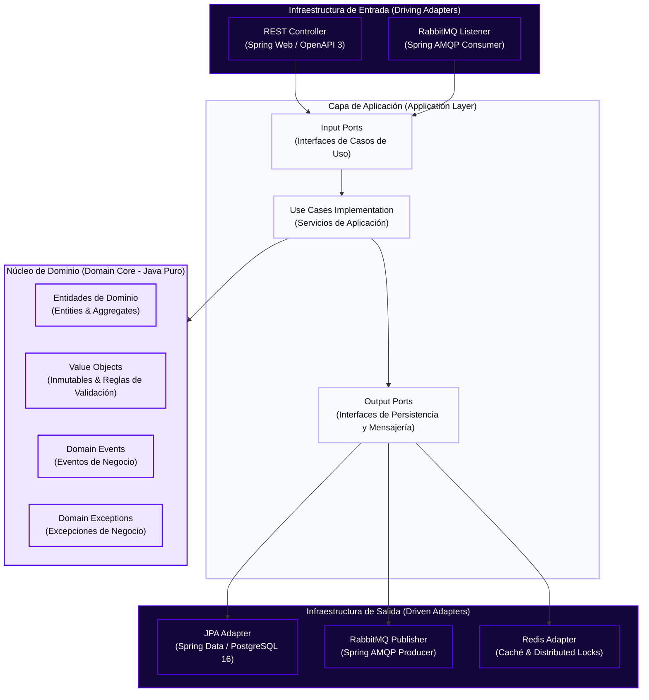
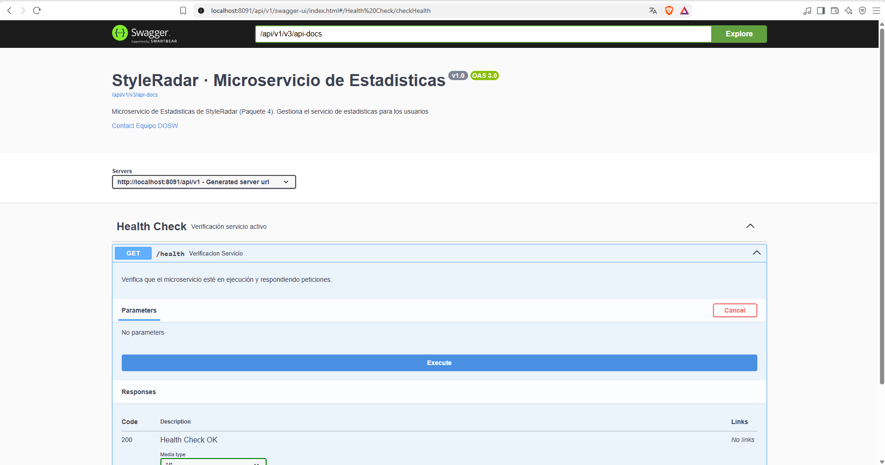
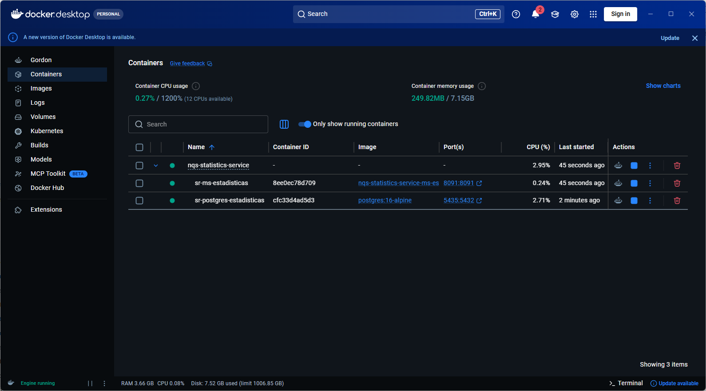
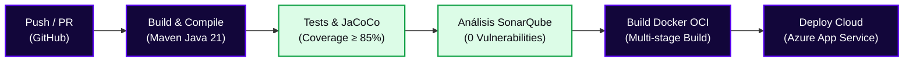
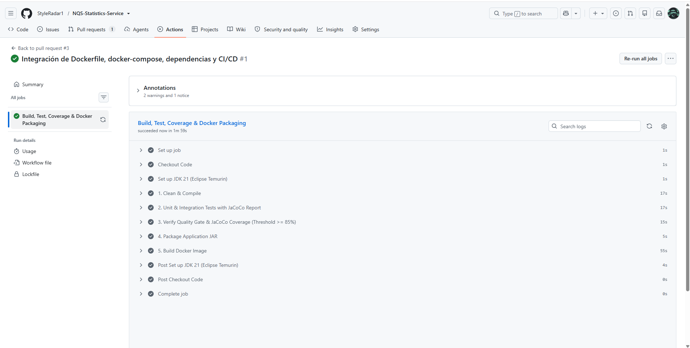
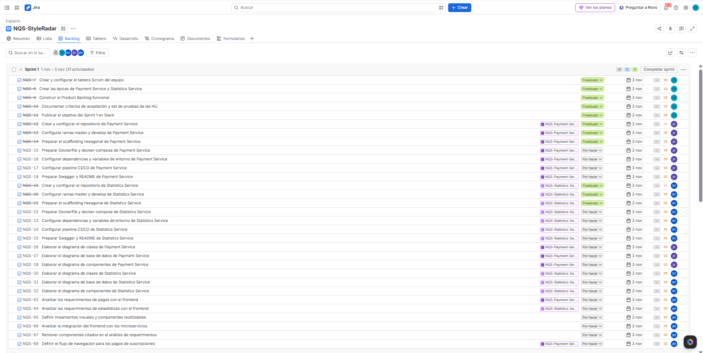

<!-- ==============================================================================
  STYLE RADAR 
  Asignatura: DOSW · 2026
  Estándar obligatorio unificado para los 13 microservicios del proyecto StyleRadar.

  INSTRUCCIONES DE USO:
  1. Reemplaza todos los campos entre <ángulos> o [corchetes] con los datos de tu microservicio.
  2. Mantén estrictamente el orden de las 12 secciones oficiales del curso.
  3. No agregues emojis para preservar la seriedad y el estándar de ingeniería.
  4. Los bloques <details> proporcionan interactividad nativa en GitHub / GitLab / Bitbucket.
============================================================================== -->

<!-- ==============================================================================
  STYLE RADAR · TIPOGRAFÍA Y SISTEMA DE DISEÑO OFICIAL
  Tipografía Oficial: Poppins (Manual de Identidad & Arquitectura Frontend)
  - Títulos Display (Black / Bold): Poppins 900 / 800 / 700
  - Subtítulos (SemiBold): Poppins 600
  - Cuerpo y Tablas (Regular): Poppins 400
  - Etiquetas y Badges (Medium): Poppins 500
  - Apoyo y Notas (Light): Poppins 300
  - Código y Terminal: JetBrains Mono
============================================================================== -->
<!-- ==============================================================================
  STYLE RADAR · RECURSOS 100% IMPORTADOS VÍA CDN / HTTPS (PORTABILIDAD TOTAL)
  Todos los logos, banners, fuentes y badges se importan desde la nube para que
  al copiar y pegar este README en cualquier repositorio nuevo se renderice
  a la perfección sin requerir archivos locales ni producir enlaces rotos.
============================================================================== -->

<div align="center">

  <a href="https://github.com/StyleRadar">
    
  </a>

  <h1>STYLE<font color="#5600EF">RADAR</font> &nbsp;·&nbsp; <code>ms-estadisticas</code></h1>

  <p align="center">
    
    
    
  </p>

  <p align="center">
    <strong><font color="#5600EF">Descubre tu estilo. En tu ciudad.</font></strong><br />
    <em>Plataforma de moda local con inventario multi-sede geolocalizado en tiempo real y probador virtual para Bogotá.</em>
  </p>

  <p align="center">
    <a href="https://styleradar-backend-prod.azurewebsites.net/swagger-ui/index.html">
      
    </a>
    <a href="https://styleradar-backend-qa.azurewebsites.net/swagger-ui/index.html">
      
    </a>
    <a href="<URL_SONARQUBE>">
      
    </a>
    <a href="target/site/jacoco/index.html">
      
    </a>
    <a href="#6-tecnologías-y-dependencias">
      
    </a>
    <a href="#6-tecnologías-y-dependencias">
      
    </a>
    <a href="#7-cómo-ejecutar-local-y-con-docker">
      
    </a>
  </p>

</div>


---

##  ÍNDICE DE CONTENIDOS

1. [Nombre del servicio y su bounded context](#1-nombre-del-servicio-y-su-bounded-context)
2. [Equipo y responsables](#2-equipo-y-responsables)
3. [Arquitectura hexagonal con su diagrama](#3-arquitectura-hexagonal-con-su-diagrama)
4. [Endpoints y enlace a Swagger](#4-endpoints-y-enlace-a-swagger)
5. [Eventos que publica y consume](#5-eventos-que-publica-y-consume)
6. [Tecnologías y dependencias](#6-tecnologías-y-dependencias)
7. [Cómo ejecutar local y con Docker](#7-cómo-ejecutar-local-y-con-docker)
8. [Variables de entorno](#8-variables-de-entorno)
9. [Pruebas y cobertura](#9-pruebas-y-cobertura)
10. [CI/CD con el badge del pipeline](#10-cicd-con-el-badge-del-pipeline)
11. [Ramas y cómo contribuir](#11-ramas-y-cómo-contribuir)
12. [Enlace a la épica en Jira](#12-enlace-a-la-épica-en-jira)

---

<a id="1-nombre-del-servicio-y-su-bounded-context"></a>

##  1. NOMBRE DEL SERVICIO Y SU BOUNDED CONTEXT

* **Identificador de Servicio:** `ms-estadisticas`
* **Paquete Arquitectónico:** `Paquete 4: estadisticas y Estadisticas`
* **Puerto de Escucha Oficial:** `8420`
* **Base de Datos Asignada:** `PostgreSQL 16` (`styleradar_statistics`), aislada bajo el patrón *Database-per-Service*.
* **Bounded Context:** `estadisticas de Suscripciones`

### Responsabilidades del Dominio

Este microservicio encapsula las responsabilidades relacionadas con la obtención y presentación de estadísticas de StyleRadar, de acuerdo con los requerimientos funcionales asignados.

| Qué HACE este Microservicio (Alcance)                             | Qué NO HACE este Microservicio (Límites)                                          |
| :----------------------------------------------------------------- | :---------------------------------------------------------------------------------- |
| • Consulta y presenta estadísticas definidas en los requerimientos del servicio.| • NO autentica usuarios (delegado a `ms-auth` en `:8081`).                     |
| • Realiza las agregaciones y cálculos estadísticos que se definan para el dominio. | • No modifica directamente los datos de negocio almacenados por otros microservicios.     |
| • Proporciona información estadística a los consumidores autorizados. | • No administra el catálogo, el inventario ni las operaciones transaccionales de las tiendas. |
| • Define cómo obtener y organizar los datos necesarios para los indicadores asignados. | • No debe asumir que tiene acceso directo a las bases de datos de otros microservicios.                 |

### Arquetipos de Moda y Personajes de StyleRadar

<div align="center">

| Antonia (Sastre) | Mateo (Calle) | Aura (Futuro) | Nora (Rebelde) | Tomás (Esencial) |
| :---: | :---: | :---: | :---: | :---: |
| <br>**Sastre**<br><sub>Tiendas & Descubrimiento</sub> | <br>**Calle**<br><sub>Playlists & Cultura Urbana</sub> | <br>**Futuro**<br><sub>Probador Virtual AI</sub> | <br>**Rebelde**<br><sub>Segunda Vida & Vintage</sub> | <br>**Esencial**<br><sub>Fundaciones & Donaciones</sub> |

</div>

---

<a id="2-equipo-y-responsables"></a>

##  2. EQUIPO Y RESPONSABLES

Desarrollado y mantenido por el **Squad `NQS: No Queremos Scrum`** para la asignatura DOSW 2026.

<div align="center">

| Rol | Nombre Completo | Usuario GitHub |
| :---: | :---: | :---: |
| **Líder y apoyo** | `Cristian Camilo Ortiz Sanchez` | [@CatrachoINXS](https://github.com/CatrachoINXS) |
| **Backend Developer** | `Juan Manuel Garzón Viracacha` | [@JuanMaGV1](https://github.com/JuanMaGV1) |
| **Backend Developer** | `Daniel Jose Villamizar Castellanos` | [@ChanguaLover4ever](https://github.com/ChanguaLover4ever) |
| **Frontend Developer** | `Julian Felipe Morales Zambrano` | [@JulianMorales2003](https://github.com/JulianMorales2003) |

</div>

---

<a id="3-arquitectura-hexagonal-con-su-diagrama"></a>

##  3. ARQUITECTURA HEXAGONAL CON SU DIAGRAMA

El microservicio implementa **Arquitectura Hexagonal (Puertos y Adaptadores)** combinada con **Domain-Driven Design (DDD)**. El núcleo de negocio permanece 100% puro y aislado de frameworks, bases de datos o brokers de mensajería.

### Diagrama Interactivo de Capas (Mermaid)



<div align="center">
  <table width="100%" style="margin: 18px 0; border: 2px dashed #C4B5FD; border-radius: 8px; background-color: #FBFBFE;">
    <tr>
      <td align="center" style="padding: 20px;">
        <p>
          <br />
          <strong><font color="#5600EF" size="3">DIAGRAMA DE ARQUITECTURA HEXAGONAL EXPORTADO (OPCIONAL)</font></strong>
        </p>
        <p>
          <sub>Si tu squad cuenta con un diagrama gráfico exportado de Draw.io, Miro o PlantUML, pégalo en este contenedor como alternativa visual.</sub>
        </p>
        <p>
<!-- <br /> -->
          <code>[ Espacio opcional para diagrama exportado · docs/evidencias/diagrama-hexagonal.png ]</code>
        </p>
      </td>
    </tr>
  </table>
</div>

### Estructura Oficial de Paquetes en `src/main/java/`

```text
src/main/java/com/styleradar/estadisticas/
├── domain/                                  <-- NÚCLEO DE DOMINIO (Cero dependencias externas)
│   ├── model/                               <-- Entidades y Agregados raíz
│   ├── valueobject/                         <-- Value Objects inmutables (PrecioCop, Talla, UUIDv7)
│   ├── event/                               <-- Definición de Eventos de Dominio
│   └── exception/                           <-- Excepciones de reglas de negocio
├── application/                             <-- CAPA DE APLICACIÓN (Casos de Uso)
│   ├── port/
│   │   ├── in/                              <-- Input Ports (Interfaces para controladores)
│   │   └── out/                             <-- Output Ports (Interfaces para repositorios y broker)
│   ├── usecase/                             <-- Implementación de casos de uso
│   └── dto/                                 <-- DTOs de entrada y salida (Java Records)
└── infrastructure/                          <-- CAPA DE INFRAESTRUCTURA (Adaptadores)
    ├── adapter/
    │   ├── in/
    │   │   ├── rest/                        <-- Spring REST Controllers y OpenAPI Spec
    │   │   └── amqp/                        <-- Consumidores de eventos RabbitMQ
    │   └── out/
    │       ├── persistence/                 <-- Spring Data JPA Repositories y Entidades SQL
    │       ├── messaging/                   <-- Productores RabbitMQ (AmqpTemplate)
    │       └── cache/                       <-- Clientes Redis (RedisTemplate / Redlock)
    └── config/                              <-- Beans de configuración Spring (Seguridad, AMQP, DB)
```

---

<a id="4-endpoints-y-enlace-a-swagger"></a>

##  4. ENDPOINTS Y ENLACE A SWAGGER

La documentación interactiva OpenAPI 3.0 y los contratos de ejecución se encuentran desplegados y clasificados por entorno:

### Matriz Oficial de Enlaces por Entorno (PROD, QA, LOCAL)

| Entorno | Estado | Propósito | URL Base del Servicio | Swagger OpenAPI UI | Health Check |
| :--- | :---: | :--- | :--- | :--- | :--- |
| **Producción (PROD)** | Próximo Sprint | Despliegue productivo de StyleRadar | Proximo Sprint | [Proximo Sprint](https://styleradar-backend-prod.azurewebsites.net/swagger-ui/index.html) | [`Proximo Sprint`](https://styleradar-backend-prod.azurewebsites.net/actuator/health) |
| **Calidad / Pruebas (QA)** | Proximo Sprint | Pruebas integradas de Sprint y QA | Proximo Sprint | [Proximo Sprint](https://styleradar-backend-qa.azurewebsites.net/swagger-ui/index.html) | [`Proximo Sprint`](https://styleradar-backend-qa.azurewebsites.net/actuator/health) |
| **Desarrollo Local (DEV)** | Local | Entorno de desarrollo local en máquina | `http://localhost:8420` | [Swagger UI Local](http://localhost:8420/swagger-ui.html) | [`/api/v1/actuator/health`](http://localhost:8420/api/v1/actuator/health) |

* **Especificación OpenAPI (Contrato JSON Schema):** `http://localhost:8420/api/v1/v3/api-docs`.


<div align="center">
  <table width="100%" style="margin: 18px 0; border: 2px dashed #5600EF; border-radius: 8px; background-color: #FBFBFE;">
    <tr>
      <td align="center" style="padding: 22px;">
        <p>
          <br />
          <strong><font color="#5600EF" size="3">DOCUMENTACIÓN SWAGGER OPENAPI UI ACTIVA</font></strong>
        </p>
        <p>
          <sub>Pega aquí la captura de pantalla de la interfaz interactiva corriendo en <code>http://localhost:8420/swagger-ui.html</code> mostrando los endpoints del controlador.</sub>
        </p>
        <p>
<!-- Al generar tu captura, descomenta la siguiente línea y guarda la imagen en la ruta indicada: -->
 <br />
          <code></code>
        </p>
      </td>
    </tr>
  </table>
</div>

### Tabla de Endpoints Expuestos

|  Método  | Endpoint                                                        | Descripción                                                                 | Rol Requerido         |       Códigos HTTP       |
| :--------: | :-------------------------------------------------------------- | :-------------------------------------------------------------------------- | :-------------------- | :-----------------------: |
|  `GET`  | `/api/v1/health`                                                | Health Check y estado del microservicio                                     | Público              |          `200`          |
|  `GET`  | `/api/v1/estadisticas/tableros/{tipo}/{idDueño}`                | Consultar indicadores del tablero por tipo y dueño (HU-04)                 | Administrador Almacén |    `200`, `400`, `404`    |
|  `GET`  | `/api/v1/estadisticas/graficas/{id}/series`                     | Consultar series de una gráfica o actividad diaria de la tienda (HU-05)     | Administrador Almacén | `200`, `400`, `404`, `500` |
|  `GET`  | `/api/v1/estadisticas/graficas/{id}`                            | Consultar gráfica completa con sus series temporales                        | Administrador Almacén |    `200`, `400`, `404`    |
|  `GET`  | `/api/v1/estadisticas/graficas/tiendas/{idTienda}/actividad-diaria` | Consultar actividad diaria de la tienda (HU-05)                         | Administrador Almacén |       `200`, `400`       |
|  `GET`  | `/api/v1/estadisticas/graficas/tiendas/{idTienda}/actividad-diaria/series` | Consultar lista de series de actividad diaria de la tienda (HU-05) | Administrador Almacén |       `200`, `400`       |

---

<a id="5-eventos-que-publica-y-consume"></a>

##  5. EVENTOS QUE PUBLICA Y CONSUME

La comunicación asíncrona entre microservicios se orquesta a través de **RabbitMQ 3.12** utilizando Topic Exchanges durables.

* Estado: Pendiente de definir el mecanismo de comunicación entre microservicios.

Se debe determinar si el servicio publicará eventos relacionados con el resultado de un pago y si consumirá eventos relacionados con suscripciones.

---

<a id="6-tecnologías-y-dependencias"></a>

##  6. TECNOLOGÍAS Y DEPENDENCIAS

El stack del microservicio cumple con el estándar unificado de arquitectura de StyleRadar:

| Capa / Componente                | Tecnología       | Versión   | Justificación Técnica                                                                        |
| :------------------------------- | :---------------- | :--------- | :--------------------------------------------------------------------------------------------- |
| **Lenguaje Core**          | Java LTS          | `21`     | Virtual Threads (Project Loom) para concurrencia masiva I/O sin saturar hilos del OS.          |
| **Framework Empresarial**  | Spring Boot       | `3.2.9`  | Gestión declarativa de configuración, ecosistema nativo Spring Data y Spring AMQP.           |
| **Base de Datos**          | PostgreSQL        | `16`     | Integridad transaccional ACID, llaves UUIDv7 y soporte de extensiones espaciales/GIN.          |
| **Migraciones de BD**      | Flyway            | `10.10.0`   | Control de versiones reproducible de scripts SQL (`V1__init.sql`) en arranque de contenedor. |
| **Broker de Mensajería**  | RabbitMQ          | `3.12.14-alpine`  | Desacoplamiento temporal de microservicios mediante Topic Exchanges durables.                  |
| **Procesador de Boilerplate**      | Project Lombok             | `1.18.38`    | Reducción declarativa de código con soporte completo para compiladores Java 21+.|
| **Mapeo de DTOs**          | MapStruct         | `1.5.5.Final`  | Generación de mappers en tiempo de compilación con cero sobrecarga de reflection.            |
| **Testing Core**           | JUnit 5 + Mockito | `5.10.3` | Pruebas unitarias sobre el núcleo de dominio sin inicializar el contenedor Spring.            |
| **Testing Integración**   | Testcontainers    | `1.19.8` | Instanciación automática de PostgreSQL y RabbitMQ en Docker durante `mvn verify`.          |
| **Métricas de Cobertura** | JaCoCo Plugin     | `0.8.12` | Verificación estricta de cobertura mínima (≥ 85%) como regla de fallo en el build.     |
| **Documentación de API** | SpringDoc OpenAPI Starter  | `2.5.0` | Generación dinámica de especificación Swagger UI interactiva y contrato OpenAPI 3. |

---

<a id="7-cómo-ejecutar-local-y-con-docker"></a>

##  7. CÓMO EJECUTAR LOCAL Y CON DOCKER

### Prerrequisitos de Entorno

* **Java Development Kit (JDK):** Versión 21 LTS instalada (`java -version`).
* **Apache Maven:** Versión 3.9+ instalada (`mvn -version`).
* **Docker Engine & Docker Compose:** Versión 24+ en ejecución (`docker --version`).

### Ejecución Local con Maven (Perfil Dev)

```bash
# 1. Clonar el repositorio
git clone https://github.com/StyleRadar/NQS-Statistics-Service.git
cd NQS-Statistics-Service# 2. Levantar servicios de infraestructura en Docker (PostgreSQL, Redis, RabbitMQ)
docker compose up -d postgres rabbitmq redis

# 3. Ejecutar el microservicio localmente
mvn clean spring-boot:run -Dspring-boot.run.profiles=dev
```

### Comprobación de Salud (Health Check)

```bash
curl -s http://localhost:8420/actuator/health | jq .
# Esperado: {"status":"UP","components":{"db":{"status":"UP"},"rabbit":{"status":"UP"}}}
```

<div align="center">
  <table width="100%" style="margin: 18px 0; border: 2px dashed #5600EF; border-radius: 8px; background-color: #FBFBFE;">
    <tr>
      <td align="center" style="padding: 22px;">
        <p>
          <br />
          <strong><font color="#5600EF" size="3">CONTENEDOR OCI DOCKER EN EJECUCIÓN (docker compose ps)</font></strong>
        </p>
        <p>
          <sub>Pega aquí la captura de terminal ejecutando <code>docker compose ps</code> mostrando el contenedor del microservicio y sus servicios de persistencia y broker en estado healthy.</sub>
        </p>
        <p>
<!-- Al generar tu captura, descomenta la siguiente línea y guarda la imagen en la ruta indicada: -->
<br /> -->
          <code></code>
        </p>
      </td>
    </tr>
  </table>
</div>


---

<a id="8-variables-de-entorno"></a>

##  8. VARIABLES DE ENTORNO

Todas las configuraciones sensibles y dependientes de entorno se externalizan mediante variables de sistema conformes al estándar **Twelve-Factor App**.

| Variable                   | Descripción                                 | Valor por Defecto (`dev`) | Requerido en Prod |
| :------------------------- | :------------------------------------------- | :-------------------------- | :---------------: |
| `SERVER_PORT`            | Puerto de escucha HTTP del microservicio     | `8420`                    |        Sí        |
| `SPRING_PROFILES_ACTIVE` | Perfil de configuración Spring Boot activo  | `dev`                     |        Sí        |
| `DB_HOST`                | Hostname o IP del servidor PostgreSQL        | `localhost`               |        Sí        |
| `DB_PORT`                | Puerto de conexión a PostgreSQL             | `5432`                    |        Sí        |
| `DB_NAME`                | Nombre de la base de datos aislada           | `styleradar_statistics`          |        Sí        |
| `DB_USER`                | Usuario de conexión a la base de datos      | `styleradar_user`         |        Sí        |
| `DB_PASSWORD`            | Contraseña del usuario de base de datos     | `styleradar_secret`         |        Sí        |
| `RABBITMQ_HOST`          | Hostname del broker de mensajería           | `localhost`               |        Sí        |
| `RABBITMQ_PORT`          | Puerto AMQP de RabbitMQ                      | `5672`                    |        Sí        |
| `RABBITMQ_USERNAME`      | Usuario de conexión a RabbitMQ              | `guest`                   |        Sí        |
| `RABBITMQ_PASSWORD`      | Contraseña de conexión a RabbitMQ          | `guest`                   |        Sí        |
| `REDIS_HOST`             | Hostname del servidor de caché Redis        | `localhost`               |        No        |
| `JWT_PUBLIC_KEY`         | Clave pública RSA/RS256 para validar tokens | `styleradar-ms-auth`     |        Sí        |

<details>
<summary><b>Click para copiar la Plantilla de Archivo .env.example</b></summary>

<br>

```dotenv
# ==============================================================================
# STYLERADAR · VARIABLES DE ENTORNO LOCALES (.env)
# ==============================================================================

SERVER_PORT=8420
SPRING_PROFILES_ACTIVE=dev
DB_HOST=localhost
DB_PORT=5434
DB_NAME=styleradar_statistics
DB_USER=styleradar_user
DB_PASSWORD=styleradar_secret
RABBITMQ_HOST=localhost
RABBITMQ_PORT=5674
RABBITMQ_USERNAME=guest
RABBITMQ_PASSWORD=guest
JWT_ISSUER=styleradar-ms-auth
```

</details>

---

<a id="9-pruebas-y-cobertura"></a>

##  9. PRUEBAS Y COBERTURA (≥ 85%)

El proyecto exige una cobertura de código mínima del **85%** verificada automáticamente mediante el plugin de **JaCoCo** durante la fase de compilación.

### Comandos de Ejecución de Pruebas

```bash
# Ejecutar todas las pruebas unitarias y de integración
mvn clean verify

# Generar únicamente el reporte HTML de JaCoCo
mvn jacoco:report
```

* **Ruta del Reporte HTML:** `target/site/jacoco/index.html`

<div align="center">
  <table width="100%" style="margin: 18px 0; border: 2px dashed #5600EF; border-radius: 8px; background-color: #FBFBFE;">
    <tr>
      <td align="center" style="padding: 22px;">
        <p>
          <br />
          <strong><font color="#5600EF" size="3">REPORTE CONSOLIDADO DE COBERTURA JACOCO (≥ 85%)</font></strong>
        </p>
        <p>
          <sub>Pega aquí la captura del reporte HTML (<code>target/site/jacoco/index.html</code>) evidenciando el cumplimiento de la cobertura mínima obligatoria (≥ 85%).</sub>
        </p>
        <p>
<!-- Al generar tu captura, descomenta la siguiente línea y guarda la imagen en la ruta indicada: -->
<!-- <br /> -->
          <code>[ Pegar captura de JaCoCo ≥ 85% aquí · docs/evidencias/cobertura-jacoco.png ]</code>
        </p>
      </td>
    </tr>
  </table>
</div>


### Pirámide de Pruebas Implementada

| Nivel de Prueba                   | Alcance                                    | Tecnologías Utilizadas          | Ubicación en el Código                                    | Cobertura Meta |
| :-------------------------------- | :----------------------------------------- | :------------------------------- | :---------------------------------------------------------- | :------------: |
| **Pruebas Unitarias**       | Lógica de Dominio y Casos de Uso aislados | JUnit 5, Mockito, AssertJ        | `src/test/java/.../domain/`, `src/test/java/.../application/` | ≥ 90% |
| **Pruebas de Integración** | Repositorios JPA y Adaptadores REST        | Spring Boot Test, Testcontainers | `src/test/java/.../infrastructure/`                       |  ≥ 85%  |
| **Pruebas de Contrato**     | Verificación de contratos OpenAPI         | MockMvc, JSON Assert             | `src/test/java/.../rest/`                                 |  ≥ 85%  |

> [!IMPORTANT]
> **Criterio de Fallo en CI:** El archivo `pom.xml` contiene la regla `<limit><minimum>0.85</minimum></limit>`. Si la cobertura total consolidada es inferior al 85%, el comando `mvn verify` fallará con error y el pipeline bloqueará el Pull Request.

---

<a id="10-cicd-con-el-badge-del-pipeline"></a>

##  10. CI/CD CON EL BADGE DEL PIPELINE

El ciclo de vida del software implementa integración continua y entrega continua automatizada mediante **GitHub Actions / Azure Pipelines**:

### Matriz de Pipelines por Entorno (PROD y QA)

| Pipeline | Entorno Destino | Desencadenador (Trigger) | Quality Gate Exigido | Badge de Estado |
| :--- | :--- | :--- | :--- | :---: |
| **CI - Staging / QA** | Calidad (`QA`) | Pull Request o Push a rama `develop` | Build OK + Tests Unitarios/Integración + JaCoCo ≥ 85% + SonarQube OK | [](https://github.com/CatrachoINXS/StyleRadar-Backend/actions) |
| **CD - Producción (PROD)** | Producción (`PROD`) | Merge a rama `main` tras validación QA | Aprobación manual + Imagen OCI desplegada en Azure App Service | [](https://github.com/CatrachoINXS/StyleRadar-Backend/actions) |
| **Quality Gate SonarQube** | Transversal | Ejecutado en cada build de CI | 0 Vulnerabilidades, 0 Bugs, Deuda Técnica &lt; 5% | [](<URL_SONARQUBE>) |

### Diagrama del Flujo Automatizado (Pipeline Stages)



### Reglas de Calidad en SonarQube (*Quality Gate Passed*)

* **Bugs:** 0
* **Vulnerabilidades:** 0
* **Hotspots de Seguridad:** 0 revisados al 100%
* **Code Smells Críticos:** 0
* **Deuda Técnica:** < 5%

<div align="center">
  <table width="100%" style="margin: 18px 0; border: 2px dashed #5600EF; border-radius: 8px; background-color: #FBFBFE;">
    <tr>
      <td align="center" style="padding: 22px;">
        <p>
          <br />
          <strong><font color="#5600EF" size="3">EJECUCIÓN DEL PIPELINE CI/CD EN VERDE (BUILD & QUALITY GATE PASSED)</font></strong>
        </p>
        <p>
          <sub>Pega aquí la captura del pipeline de integración continua (Azure DevOps / GitHub Actions) finalizado con éxito en todas sus fases.</sub>
        </p>
        <p>
<!-- Al generar tu captura, descomenta la siguiente línea y guarda la imagen en la ruta indicada: -->
<br /> 
          <code></code>
        </p>
      </td>
    </tr>
  </table>
</div>

---

<a id="11-ramas-y-cómo-contribuir"></a>

##  11. RAMAS Y CÓMO CONTRIBUIR

El equipo sigue el modelo de trabajo **GitFlow adaptado para microservicios**. La rama `main` se encuentra protegida y solo recibe cambios mediante Pull Requests aprobados.

### Estructura de Ramas Oficial

```text
main                    <-- Código en producción (Desplegado en Azure PROD)
└── develop             <-- Rama de integración continua (Staging / QA)
    ├── feature/SR-<ID>-<descripcion-corta>   <-- Nuevas funcionalidades
    ├── bugfix/SR-<ID>-<descripcion-corta>    <-- Corrección de defectos
    └── hotfix/<descripcion-corta>            <-- Parche urgente a main
```

### Convención de Commits (*Conventional Commits*)

Todo mensaje de commit debe seguir el estándar:

```text
<tipo>(<alcance>): <descripción imperativa en español> [#SR-RF-XX]

Ejemplos válidos:
feat(catalogo): agregar filtro de prendas por ocasión y estilo [#SR-RF-13]
fix(inventario): corregir condición de carrera en reserva de talla [#SR-RF-48]
test(dominio): agregar pruebas unitarias para entidad Prenda [#SR-RF-50]
docs(readme): actualizar variables de entorno y topología de eventos
```

### Checklist Obligatorio para Pull Requests

- [ ] La rama parte de la versión más reciente de `develop`.
- [ ] El código compila limpiamente con `mvn clean compile`.
- [ ] Todas las pruebas unitarias e integración pasan (`mvn verify`).
- [ ] La cobertura JaCoCo es mayor o igual al 85%.
- [ ] No se introducen credenciales, contraseñas ni tokens en el código fuente.
- [ ] El PR tiene asignado al menos 1 revisor del squad antes del merge.

---

<a id="12-enlace-a-la-épica-en-jira"></a>

##  12. ENLACE A LA ÉPICA EN JIRA

El seguimiento de requerimientos, evidencias y artefactos de entrega se centraliza en los siguientes enlaces oficiales:

### Enlaces de Gestión, Repositorios y Evidencias

* **Épica Oficial del Microservicio (Jira):** [https://mail-team-hdkr3g6f.atlassian.net/browse/NQS-6](https://mail-team-hdkr3g6f.atlassian.net/browse/NQS-6)
* **Tablero Scrum del Squad (Jira):** [https://mail-team-hdkr3g6f.atlassian.net/jira/software/projects/NQS/boards/1?filter=&groupBy=none](https://mail-team-hdkr3g6f.atlassian.net/jira/software/projects/NQS/boards/1?filter=&groupBy=none)

<div align="center">
  <table width="100%" style="margin: 18px 0; border: 2px dashed #5600EF; border-radius: 8px; background-color: #FBFBFE;">
    <tr>
      <td align="center" style="padding: 22px;">
        <p>
          <br />
          <strong><font color="#5600EF" size="3">TABLERO SCRUM Y SEGUIMIENTO DE LA ÉPICA EN JIRA</font></strong>
        </p>
        <p>
          <sub>Pega aquí la captura del tablero de Jira mostrando la Épica, User Stories y tareas asignadas al microservicio para el sprint.</sub>
        </p>
        <p>
<!-- Al generar tu captura, descomenta la siguiente línea y guarda la imagen en la ruta indicada: -->
 <br />
          <code></code>
        </p>
      </td>
    </tr>
  </table>
</div>

### Requerimientos Funcionales Asignados

| Código RF | Nombre del Requerimiento | Historia en Jira |
|---|---|---|
| `SR-RF-76` | Consultar indicadores de la tienda | `NQS-36` |
| `SR-RF-77` | Consultar actividad diaria de la tienda | `NQS-37` |
| `SR-RF-78` | Consultar visitantes de la tienda en tiempo real | `NQS-38` |
| `SR-RF-79` | Consultar avance de la meta semanal de visitas | `NQS-39` |
| `SR-RF-80` | Consultar prendas más guardadas | `NQS-40` |
| `SR-RF-81` | Consultar inventario por estado | `NQS-41` |
| `SR-RF-82` | Consultar indicadores de donaciones | `NQS-42` |
| `SR-RF-83` | Consultar solicitudes de donación por mes | `NQS-43` |
| `SR-RF-84` | Consultar avance de la meta mensual de prendas | `NQS-44` |
| `SR-RF-85` | Consultar distribución de donaciones | `NQS-45` |
| `SR-RF-86` | Consultar indicadores generales de la plataforma | `NQS-46` |
| `SR-RF-87` | Revisar publicaciones pendientes por grupos | `NQS-47` |
| `SR-RF-88` | Consultar actividad diaria de la plataforma | `NQS-48` |
| `SR-RF-89` | Consultar ingresos por suscripciones | `NQS-49` |
| `SR-RF-90` | Consultar usuarios conectados en tiempo real | `NQS-50` |
| `SR-RF-91` | Consultar cuentas por plan | `NQS-51` |