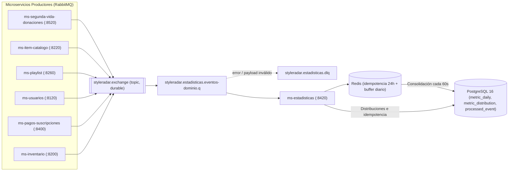
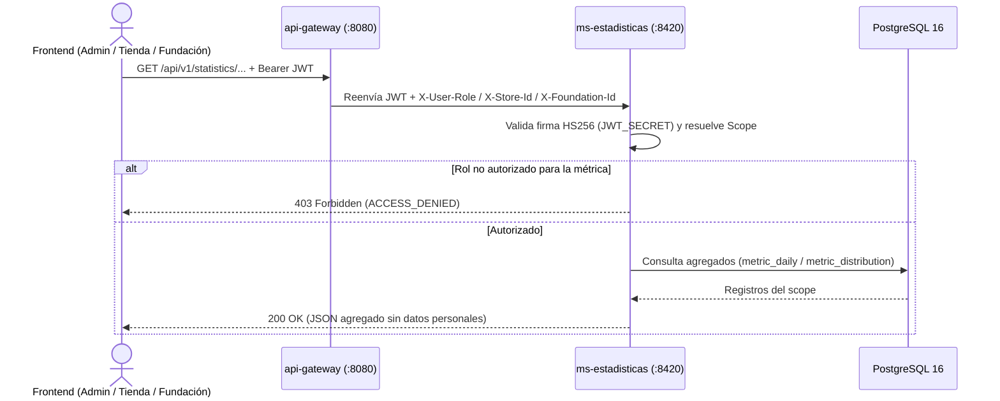

# Plan de Acción para la Culminación de `ms-estadisticas` (`:8420`)

> **Alcance vigente:** Microservicio refactorizado a **9 indicadores**, **3 endpoints REST** y **6 microservicios productores** vía RabbitMQ (`styleradar.exchange`), con persistencia en PostgreSQL 16 (Flyway `V1`–`V9`) y buffer diario en Redis.  
> **Pipeline CI/CD:** `.github/workflows/ci-cd.yml` (Java 21, Spring Boot 3.2.9, JaCoCo ≥ 85%, despliegue a QA desde `develop` y a PROD desde `master`/`main`).

---

## 1. Resumen del Alcance Sobreviviente

| # | Indicador | RF | `MetricCode` | Rol autorizado | Endpoint REST |
|---:|---|---|---|---|---|
| 1 | Total prendas recibidas por fundación | `SR-RF-82.1` | `FOUNDATION_GARMENTS_RECEIVED` | `FOUNDATION_REPRESENTATIVE` | `GET /api/v1/statistics/summary/totals/FOUNDATION_GARMENTS_RECEIVED` |
| 2 | Total prendas publicadas | `SR-RF-86.4` | `PLATFORM_GARMENT_PUBLICATIONS` | `STYLERADAR_ADMIN` | `GET /api/v1/statistics/summary/totals/PLATFORM_GARMENT_PUBLICATIONS` |
| 3 | Total playlist creadas | `SR-RF-86.5` | `PLATFORM_PLAYLISTS_CREATED` | `STYLERADAR_ADMIN` | `GET /api/v1/statistics/summary/totals/PLATFORM_PLAYLISTS_CREATED` |
| 4 | Registros diarios de usuarios | `SR-RF-88.2` | `PLATFORM_USER_REGISTRATIONS` | `STYLERADAR_ADMIN` | `GET /api/v1/statistics/time-series/PLATFORM_USER_REGISTRATIONS` |
| 5 | Histórico mensual de ingresos | `SR-RF-89.1` | `PLATFORM_SUBSCRIPTION_REVENUE` | `STYLERADAR_ADMIN` | `GET /api/v1/statistics/time-series/PLATFORM_SUBSCRIPTION_REVENUE` |
| 6 | Inventario por estado | `SR-RF-81` | `STORE_INVENTORY_BY_STATE` | `STORE_ADMIN` | `GET /api/v1/statistics/distributions/STORE_INVENTORY_BY_STATE` |
| 7 | Cuentas de usuarios compradores | `SR-RF-91.1` | `PLATFORM_BUYERS_BY_PLAN` | `STYLERADAR_ADMIN` | `GET /api/v1/statistics/distributions/PLATFORM_BUYERS_BY_PLAN` |
| 8 | Cuentas de almacenes | `SR-RF-91.2` | `PLATFORM_STORES_BY_PLAN` | `STYLERADAR_ADMIN` | `GET /api/v1/statistics/distributions/PLATFORM_STORES_BY_PLAN` |
| 9 | Donaciones del mes | `SR-RF-86.6` | `PLATFORM_MONTHLY_DONATIONS` | `STYLERADAR_ADMIN` | `GET /api/v1/statistics/summary/totals/PLATFORM_MONTHLY_DONATIONS` |

---

## 2. Diagramas de Arquitectura y Flujo (Referencia para Documentación)

### 2.1 Arquitectura de Integración (6 Productores → 3 Endpoints)

### 2.2 Flujo de Consulta Autenticada

---

## 3. Tareas Pendientes para Culminación

### Bloque 1: Cierre del PR e Infraestructura en QA (`develop`)
- [ ] **Aprobar y mergear PR** de `refactor/core-nine-metrics` → `develop` y confirmar que el job `deploy-qa` de `.github/workflows/ci-cd.yml` construya y reinicie `sr-ms-estadisticas-qa`.
- [ ] **Verificar migración Flyway `V9` en PostgreSQL QA:** confirmar que `V9__cleanup_obsolete_tables_and_metrics.sql` eliminó `metric_goal` y `metric_item_daily` y limpió filas obsoletas sin errores de checksum.
- [ ] **Limpiar topología huérfana en RabbitMQ QA:** verificar en la consola de RabbitMQ que `styleradar.estadisticas.eventos-dominio.q` tenga únicamente los **7 bindings exactos** y eliminar manualmente la cola obsoleta `styleradar.estadisticas.alerta-creada.q` (y los bindings `#` anteriores si quedaron en el broker).

### Bloque 2: Seguridad Transversal (`ms-auth` + `api-gateway`)
- [ ] **Validar `JWT_SECRET` compartido en QA:** confirmar que `ms-auth` y `ms-estadisticas` usan exactamente el mismo secreto Base64 HS256.
- [ ] **Validar claims y cabeceras en rutas reales:**
  - `STORE_ADMIN` → JWT/header incluye `storeId` (o `nit` / `X-Store-Id`).
  - `FOUNDATION_REPRESENTATIVE` → JWT/header incluye `foundationId` (`X-Foundation-Id`).
  - `STYLERADAR_ADMIN` → acceso únicamente a las 7 métricas `PLATFORM`.
  - `BUYER` → rechazo con `403 Forbidden` en cualquier ruta de `/api/v1/statistics/**`.
- [ ] **Validar `401 Unauthorized`** cuando no se envía JWT o está expirado.

### Bloque 3: Matriz de Pruebas E2E en QA (9 Indicadores)

> Ejecutar cada prueba publicando o disparando el flujo real en el microservicio productor, esperando hasta 60s (ciclo de `CounterConsolidationScheduler` para métricas diarias) y consultando el endpoint en Swagger/Postman con el rol correspondiente.

- [ ] **#1 `FOUNDATION_GARMENTS_RECEIVED` (`ms-segunda-vida-donaciones`):**
  - Confirmar recepción de una donación con `cantidad: 3` → verificar que `GET /api/v1/statistics/summary/totals/FOUNDATION_GARMENTS_RECEIVED` incremente en `3` para esa fundación.
- [ ] **#2 `PLATFORM_GARMENT_PUBLICATIONS` (`ms-item-catalogo`):**
  - Publicar una prenda en catálogo → verificar que `GET /api/v1/statistics/summary/totals/PLATFORM_GARMENT_PUBLICATIONS` incremente en `1`.
- [ ] **#3 `PLATFORM_PLAYLISTS_CREATED` (`ms-playlist`):**
  - Crear una playlist → verificar que `GET /api/v1/statistics/summary/totals/PLATFORM_PLAYLISTS_CREATED` incremente en `1`.
- [ ] **#4 `PLATFORM_USER_REGISTRATIONS` (`ms-usuarios`):**
  - Registrar un usuario nuevo → verificar incremento en el día actual (`America/Bogota`) en `GET /api/v1/statistics/time-series/PLATFORM_USER_REGISTRATIONS`.
- [ ] **#5 `PLATFORM_SUBSCRIPTION_REVENUE` (`ms-pagos-suscripciones`):**
  - Confirmar un pago aprobado en COP (`data.monto`) → verificar suma en el mes actual en `GET /api/v1/statistics/time-series/PLATFORM_SUBSCRIPTION_REVENUE`.
- [ ] **#6 `STORE_INVENTORY_BY_STATE` (`ms-inventario`):**
  - Probar creación inicial (`stockAnterior: null`, `stockDisponible: 10` → `+1 AVAILABLE`) y actualización (`stockAnterior: 10`, `stockDisponible: 2` → `-1 AVAILABLE`, `+1 LOW_STOCK`) → verificar porcentajes en `GET /api/v1/statistics/distributions/STORE_INVENTORY_BY_STATE`.
- [ ] **#7 `PLATFORM_BUYERS_BY_PLAN` (`ms-pagos-suscripciones` + `ms-estadisticas`):**
  - Registrar suscripción inicial de comprador (`planAnterior: null`, `planActual: PLAN_RADAR`) y actualizar plan a `PLAN_RADAR_PLUS` (`-1 PLAN_RADAR`, `+1 PLAN_RADAR_PLUS`) → verificar en `GET /api/v1/statistics/distributions/PLATFORM_BUYERS_BY_PLAN`.
- [ ] **#8 `PLATFORM_STORES_BY_PLAN` (`ms-pagos-suscripciones`):**
  - Activar plan de almacén (`PLAN_STORE_MONTHLY`) y simular suspensión (`SUSPENDED`) → verificar en `GET /api/v1/statistics/distributions/PLATFORM_STORES_BY_PLAN`.
- [ ] **#9 `PLATFORM_MONTHLY_DONATIONS` (`ms-segunda-vida-donaciones`):**
  - Confirmar recepción de donación → verificar incremento `+1` del mes en curso en `GET /api/v1/statistics/summary/totals/PLATFORM_MONTHLY_DONATIONS`.
- [ ] **Prueba de Idempotencia y DLQ:**
  - Reenviar un mismo `eventId` dos veces y confirmar que no duplica conteos (`processed_event` + Redis).
  - Enviar un JSON malformado y verificar que cae una sola vez a `styleradar.estadisticas.dlq`.

### Bloque 4: Documentación, Diagramas y Evidencias
- [ ] **Actualizar `README.md` y `.env.example`:**
  - Actualizar sección de endpoints REST (dejar solo los 3 endpoints y los 9 códigos de métrica).
  - Actualizar sección de topología RabbitMQ con los 7 routing keys exactos.
  - Actualizar variables de entorno reales (`JWT_SECRET` HS256, `RABBITMQ_SSL_ENABLED`, truststore, Redis).
  - Incrustar los diagramas Mermaid de arquitectura y flujo de consulta.
- [ ] **Actualizar `docs/contratos-integracion-estadisticas.html`** (o retirarlo si se adopta únicamente `docs/contratos-eventos-microservicios.md`).
- [ ] **Actualizar evidencias gráficas en `docs/evidencias/`:**
  - `swagger-ui.png` con los 3 grupos de endpoints vigentes.
  - `cobertura-jacoco.png` mostrando cobertura ≥ 85% tras el refactor.
  - `pipeline-ci-cd.png` con el run en verde de `Build, Test, Coverage & Docker Packaging` y `Deploy to QA`.
- [ ] **Limpiar archivos locales no versionados** antes de capturas o releases (`app.log`, `app_dev.log`, `hs_err_pid*.log`, `replay_pid*.log`).

### Bloque 5: Calidad, Salud y Despliegue a Producción (`master`)
- [ ] **Habilitar Health Check real de RabbitMQ:** quitar `management.health.rabbit.enabled: false` de `src/main/resources/application.yml` (mantenerlo deshabilitado solo en `src/test/resources/application.yml`) y apuntar Azure App Service Health Check a `/api/v1/actuator/health`.
- [ ] **Integrar SonarQube en `.github/workflows/ci-cd.yml`:** añadir paso de análisis estático y validar Quality Gate sin code smells críticos.
- [ ] **Aprovisionar y verificar entorno PROD en Azure (`rg-styleradar-estadisticas-prod`):**
  - App Service `sr-ms-estadisticas-prod` conectado a `acrstyleradarestadisticas.azurecr.io/sr-ms-estadisticas:prod`.
  - PostgreSQL 16 PROD (`styleradar_statistics`), Redis PROD y credenciales RabbitMQ PROD (`5671` AMQPS).
  - Variables de entorno configuradas (`SERVER_PORT=8420`, `DB_*`, `REDIS_*`, `RABBITMQ_*`, `JWT_SECRET`).
  - Validar si `Dockerfile` requiere parametrizar `rabbitmq-ca.pem` / `rabbitmq-truststore.jks` para el broker de PROD.
- [ ] **Gobernanza y Release a `master`:**
  - Activar *Branch Protection Rules* en `develop` y `master` (PR obligatorio + check CI en verde).
  - Abrir PR `develop` → `master`, desplegar a PROD y ejecutar *Smoke Tests* (`/api/v1/health`, Swagger UI, JWT y consumo en colas PROD).
