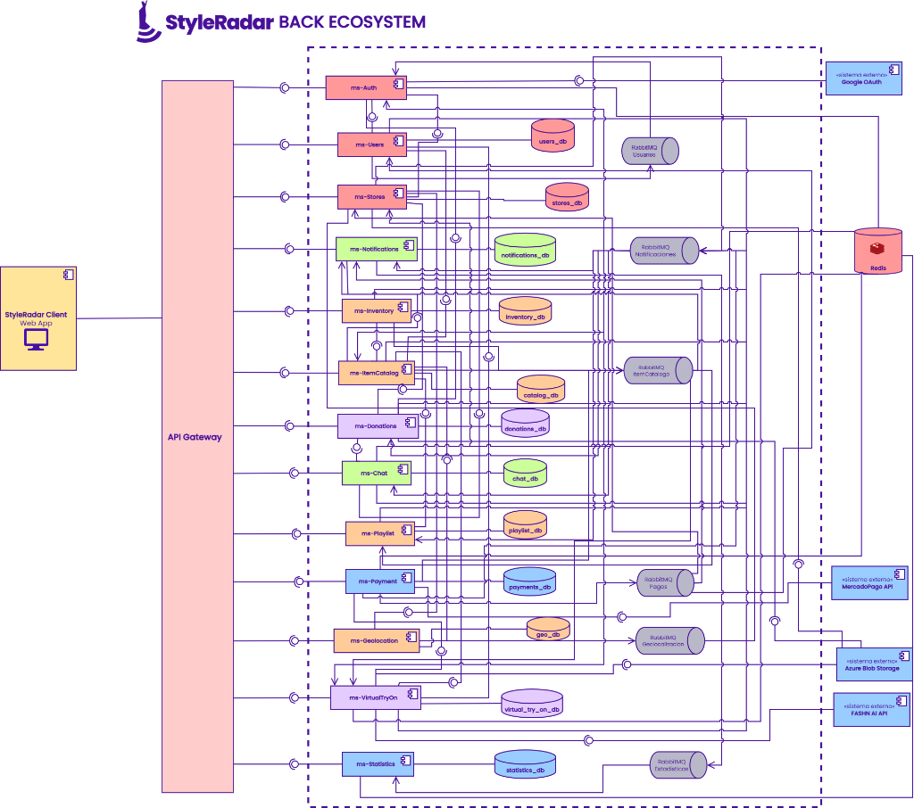
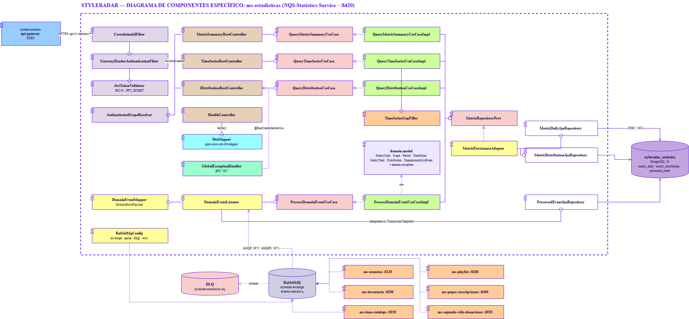
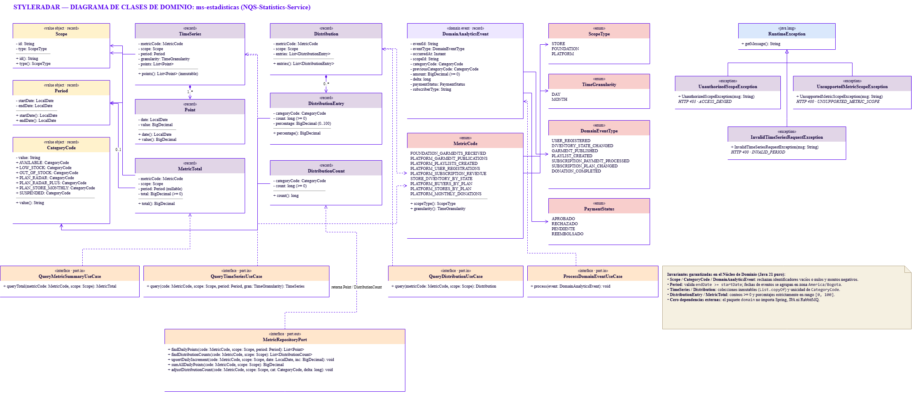
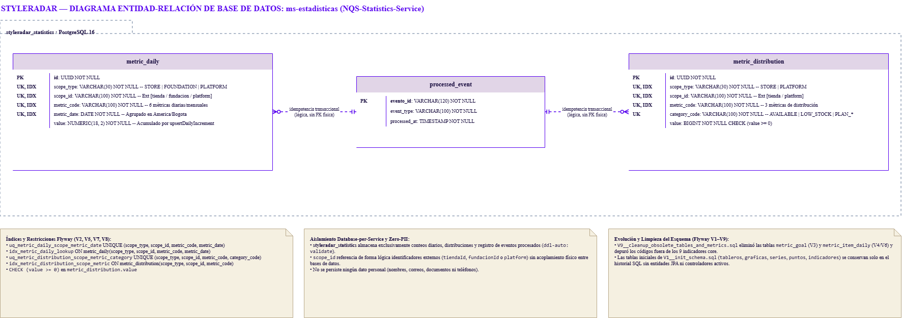
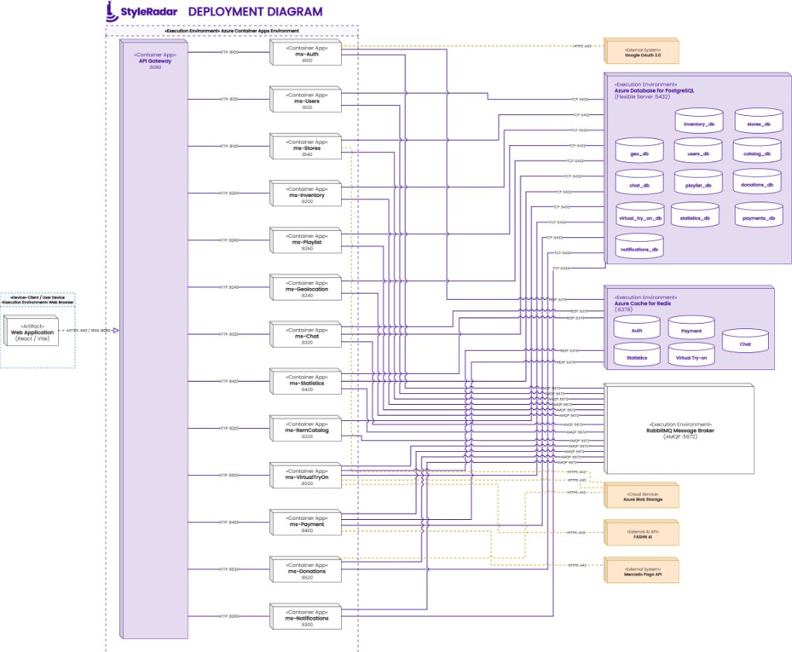
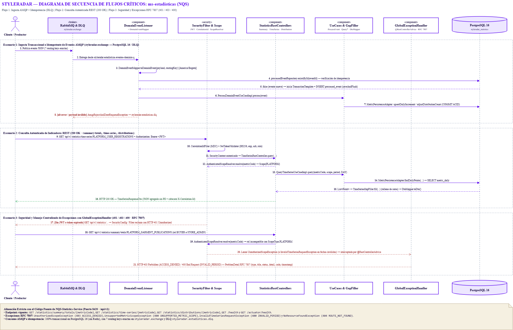

[⬅ Volver al README Principal](../../README.md)

---

## 2. ARQUITECTURA HEXAGONAL CON SUS DIAGRAMAS

El microservicio `NQS-Statistics-Service` (`ms-estadisticas`) implementa **Arquitectura Hexagonal (Puertos y Adaptadores)** combinada con principios de **Domain-Driven Design (DDD)**. El núcleo de dominio en Java puro (`domain/`) define sus modelos inmutables, excepciones de negocio y puertos de entrada/salida, permaneciendo desacoplado de Spring Web, JPA, Security y RabbitMQ.

---

### Diagramas del Microservicio

---

#### 2.1 Diagrama de Componentes General (Ecosistema StyleRadar)

<div align="center">
  
</div>

##### Justificación y Explicación Técnica de la Arquitectura del Ecosistema

Este diagrama posiciona a `ms-estadisticas` (`:8420`) dentro de la malla de microservicios de **StyleRadar**, delimitando las fronteras de integración síncrona y asíncrona:

* **Puerta de Entrada Perimetral (`api-gateway :8080`):**
  * Centraliza el acceso desde la aplicación cliente web hacia la red interna de microservicios.
  * Enruta las consultas de analítica (`/api/v1/statistics/**`) hacia `ms-estadisticas` en el puerto `8420`, propagando el token `Bearer JWT` y las cabeceras autoritativas de contexto (`X-User-Role`, `X-Store-Id`, `X-Foundation-Id`, `X-Correlation-Id`).
* **Consumo Asíncrono desde 6 Microservicios Productores (RabbitMQ `styleradar.exchange`):**
  * `ms-estadisticas` actúa únicamente como **consumidor** de eventos publicados en el Topic Exchange `styleradar.exchange` hacia la cola durable `styleradar.estadisticas.eventos-dominio.q` (con DLQ `styleradar.estadisticas.dlq`):
    * `ms-usuarios` (`:8120`) → `styleradar.usuarios.usuario.registrado`
    * `ms-inventario` (`:8200`) → `styleradar.inventario.actualizado`
    * `ms-item-catalogo` (`:8220`) → `styleradar.catalogo.prenda.publicada`
    * `ms-playlist` (`:8260`) → `styleradar.playlist.creada`
    * `ms-pagos-suscripciones` (`:8400`) → `styleradar.pagos.pago.confirmado` y `styleradar.pagos.suscripcion.plan.actualizado`
    * `ms-segunda-vida-donaciones` (`:8520`) → `styleradar.donaciones.completada`
* **Aislamiento de Persistencia (*Database-per-Service*):**
  * Toda la analítica consolidada reside en su propia base de datos relacional PostgreSQL 16 (`styleradar_statistics`), sin consultar ni acoplarse a bases de datos de otros servicios.

---

#### 2.2 Diagrama de Componentes Específico (Arquitectura Hexagonal NQS)

<div align="center">
  
</div>

##### Justificación y Explicación Técnica de la Arquitectura Interna

Modela las capas internas de `NQS-Statistics-Service` siguiendo el flujo de entrada hacia el núcleo y salida hacia persistencia:

* **Adaptadores de Entrada (`Driving Adapters`):**
  * **REST Controllers:** `MetricSummaryRestController` (`/statistics/summary`), `TimeSeriesRestController` (`/statistics/time-series`), `DistributionRestController` (`/statistics/distributions`) y `HealthController` (`/health`).
  * **AMQP Consumer (`infrastructure.messaging.amqp`):** `DomainEventListener` escucha `styleradar.estadisticas.eventos-dominio.q` y delega el mapeo a `DomainEventMapper` sobre `DomainEventPayload`.
  * **Seguridad y Transversalidad (`infrastructure.security`, `infrastructure.exception`):** `CorrelationIdFilter`, `GatewayHeaderAuthenticationFilter`, `JwtTokenValidator`, `AuthenticatedScopeResolver` y `GlobalExceptionHandler`.
* **Puertos de Entrada y Casos de Uso (`domain.port.in` & `application.usecase`):**
  * `ProcessDomainEventUseCase` → `ProcessDomainEventUseCaseImpl`
  * `QueryMetricSummaryUseCase` → `QueryMetricSummaryUseCaseImpl`
  * `QueryTimeSeriesUseCase` → `QueryTimeSeriesUseCaseImpl` (apoyado en `TimeSeriesGapFiller`)
  * `QueryDistributionUseCase` → `QueryDistributionUseCaseImpl`
* **Núcleo de Dominio (`domain.model`, `domain.exception`):**
  * Records y enums puros en Java 21 (`DomainAnalyticsEvent`, `MetricCode`, `DomainEventType`, `Scope`, `ScopeType`, `Period`, `TimeGranularity`, `Point`, `TimeSeries`, `MetricTotal`, `Distribution`, `DistributionEntry`, `DistributionCount`, `CategoryCode`, `PaymentStatus`).
* **Puerto de Salida y Adaptador de Persistencia (`domain.port.out` & `infrastructure.adapter.out.persistence`):**
  * `MetricRepositoryPort` implementado por `MetricPersistenceAdapter`, respaldado por `MetricDailyJpaRepository`, `MetricDistributionJpaRepository` y `ProcessedEventJpaRepository` sobre PostgreSQL 16.
  * El procesamiento de eventos es directamente transaccional en PostgreSQL (`TransactionTemplate` + `ProcessedEventEntity`), sin caché intermedia en Redis.

---

#### 2.3 Diagrama de Clases del Modelo de Dominio

<div align="center">
  
</div>

##### Justificación y Explicación Técnica del Modelo de Dominio

El núcleo de dominio en `edu.dosw.styleradar.estadisticas.domain` está compuesto por tipos inmutables (Java `record` y `enum`) con validación de invariantes en sus constructores compactos:

* **Identificación de Métrica y Alcance:**
  * `MetricCode` (enum con los 9 indicadores vigentes, asociando cada uno a su `ScopeType` y `TimeGranularity` por defecto).
  * `Scope(String id, ScopeType type)` (`STORE`, `FOUNDATION`, `PLATFORM`) y `Period(LocalDate startDate, LocalDate endDate)` con validación de nulidad y orden cronológico.
* **Modelos de Consulta:**
  * `MetricTotal(MetricCode metricCode, Scope scope, Period period, BigDecimal total)` para totales acumulados o del mes en curso.
  * `TimeSeries(MetricCode metricCode, Scope scope, Period period, TimeGranularity granularity, List<Point> points)` con lista inmutable de `Point(LocalDate date, BigDecimal value)`.
  * `Distribution(MetricCode metricCode, Scope scope, List<DistributionEntry> entries)` garantizando unicidad de `CategoryCode` por distribución, junto a `DistributionCount(CategoryCode categoryCode, long count)` y `DistributionEntry(CategoryCode categoryCode, long count, BigDecimal percentage)`.
* **Modelo de Ingesta de Eventos:**
  * `DomainAnalyticsEvent` encapsula `eventId`, `eventType` (`DomainEventType`), `occurredAt`, `scopeId`, `categoryCode`, `previousCategoryCode`, `amount`, `delta`, `paymentStatus` (`PaymentStatus`) y `subscriberType`.
* **Excepciones de Dominio (`domain.exception`):**
  * `UnauthorizedScopeException` (`403 ACCESS_DENIED`), `UnsupportedMetricScopeException` (`400 UNSUPPORTED_METRIC_SCOPE`) e `InvalidTimeSeriesRequestException` (`400 INVALID_PERIOD`).

---

#### 2.4 Diagrama de Base de Datos (`styleradar_statistics` · PostgreSQL 16)

<div align="center">
  
</div>

##### Justificación y Explicación Técnica del Diseño Físico de Persistencia

El esquema relacional `styleradar_statistics` está versionado con **Flyway (`V1` a `V9`)** y validado en arranque con `spring.jpa.hibernate.ddl-auto: validate`:

* **Tablas Activas del Modelo Core:**
  1. **`metric_daily` (`V2`):** Almacena valores diarios agregados por `(scope_type, scope_id, metric_code, metric_date)` con `id UUID PRIMARY KEY`, `value NUMERIC(18, 2)` y restricción única `uq_metric_daily_scope_metric_date`, más índice compuesto `idx_metric_daily_lookup` (`V8`). Se actualiza de forma atómica mediante `upsertDailyIncrement`.
  2. **`metric_distribution` (`V5`):** Almacena conteos por categoría `(scope_type, scope_id, metric_code, category_code)` con `value BIGINT CHECK (value >= 0)`, restricción `uq_metric_distribution_scope_metric_category` e índice `idx_metric_distribution_scope_metric`.
  3. **`processed_event` (`V7`):** Garantiza idempotencia transaccional en el consumo AMQP almacenando `evento_id VARCHAR(120) PRIMARY KEY`, `event_type VARCHAR(100)` y `processed_at TIMESTAMP`.
* **Evolución y Limpieza del Esquema (`V1`, `V3`, `V4`, `V6`, `V9`):**
  * La migración `V9__cleanup_obsolete_tables_and_metrics.sql` eliminó las tablas `metric_goal` (`V3`) y `metric_item_daily` (`V4`/`V6`) y depuró los `metric_code` obsoletos fuera de los 9 indicadores vigentes.
  * Las tablas iniciales de `V1__init_schema.sql` (`tableros`, `graficas`, `series`, `puntos`, `indicadores`) permanecen en el historial SQL inicial sin entidades JPA ni controladores activos que las consuman.

---

#### 2.5 Diagrama de Despliegue (Topología de Infraestructura y Contenedores)

<div align="center">
  
</div>

##### Justificación y Explicación Técnica de la Infraestructura de Despliegue

Describe la topología física en entornos locales (Docker Compose) y en la nube (**Microsoft Azure**):

* **Contenedor del Microservicio (`sr-ms-estadisticas` / Azure App Service):**
  * Construido mediante `Dockerfile` multi-stage (`maven:3.9-eclipse-temurin-21` → `eclipse-temurin:21-jre-alpine`), exponiendo el puerto `8420` con context path `/api/v1`.
  * En QA (`sr-ms-estadisticas-qa`) y PROD (`sr-ms-estadisticas-prod`), la imagen se aloja en **Azure Container Registry (`acrstyleradarestadisticas.azurecr.io`)** e incorpora el certificado CA de RabbitMQ en `/app/rabbitmq-truststore.jks` (PKCS12) durante el build de CI/CD.
* **Persistencia Relacional (`PostgreSQL 16` · `:5432` interno / `:5435` host local):**
  * Base aislada `styleradar_statistics` dedicada exclusivamente a `ms-estadisticas`.
* **Broker de Mensajería (`RabbitMQ 3.12`):**
  * En local opera por AMQP (`5672`, perfil `dev` sin SSL). En QA y PROD opera mediante **AMQPS con TLS (`5671`)** y verificación de hostname habilitada.

---

#### 2.6 Diagrama de Secuencia de Flujos Críticos (Ingesta AMQP, Consulta REST y Errores)

<div align="center">
  
</div>

##### Justificación y Explicación Técnica de los Flujos de Ejecución

Detalla los tres escenarios operativos principales del microservicio:

1. **Ingesta Transaccional e Idempotente de Eventos AMQP (`RabbitMQ` → `PostgreSQL`):**
   * `DomainEventListener` recibe `DomainEventPayload` y el header `amqp_receivedRoutingKey` desde `styleradar.estadisticas.eventos-dominio.q`.
   * `DomainEventMapper` normaliza campos, zona `America/Bogota`, estados de pago o stock (`0`, `1..3`, `>=4`). Si el payload es inválido, lanza `AmqpRejectAndDontRequeueException` hacia `styleradar.estadisticas.dlq`.
   * Si `processedEventRepository.existsById(eventId)` es `true`, descarta el duplicado. En caso contrario, dentro de `TransactionTemplate`, persiste `ProcessedEventEntity` y ejecuta `ProcessDomainEventUseCaseImpl.process(event)` en la misma transacción ACID.
2. **Consulta Autenticada de Indicadores (`200 OK`):**
   * `CorrelationIdFilter` asigna `X-Correlation-Id` en `MDC` y respuesta HTTP.
   * `GatewayHeaderAuthenticationFilter` valida el `Bearer JWT` (`HS256`) con `JwtTokenValidator` (o cabeceras `X-User-Role`, `X-Store-Id`, `X-Foundation-Id`).
   * El controlador invoca `AuthenticatedScopeResolver.resolve(metricCode)` para fijar el `Scope`, ejecuta el caso de uso correspondiente (`QueryMetricSummaryUseCase`, `QueryTimeSeriesUseCase` con `TimeSeriesGapFiller`, o `QueryDistributionUseCase`) y transforma la respuesta con `DtoMapper`.
3. **Manejo Centralizado de Errores y Seguridad (`401` / `403` / `400`):**
   * Peticiones sin autenticación o con JWT inválido hacia `/statistics/**` reciben `401 Unauthorized` en la capa de seguridad.
   * Roles incompatibles con el `ScopeType` de la métrica (ej. `BUYER` o un `STORE_ADMIN` consultando métricas `PLATFORM`) lanzan `UnauthorizedScopeException`, que `GlobalExceptionHandler` convierte en `403 Forbidden` (`code: ACCESS_DENIED`).
   * Errores de rango de fechas, granularidad o parámetros inválidos retornan `400 Bad Request` (`INVALID_PERIOD`, `UNSUPPORTED_METRIC_SCOPE`, `INVALID_PARAMETER`).

---

### Estructura Oficial de Paquetes en `src/main/java/edu/dosw/styleradar/estadisticas/`

```text
src/main/java/edu/dosw/styleradar/estadisticas/
├── EstadisticasApplication.java                     <-- Punto de entrada Spring Boot
├── domain/                                          <-- NÚCLEO DE DOMINIO (Java puro, sin Spring/JPA)
│   ├── model/                                       <-- Records y Enums (MetricCode, DomainAnalyticsEvent, Scope, Period, TimeSeries, Distribution, MetricTotal)
│   ├── port/
│   │   ├── in/                                      <-- Puertos de entrada (ProcessDomainEventUseCase, QueryTimeSeriesUseCase, QueryMetricSummaryUseCase, QueryDistributionUseCase)
│   │   └── out/                                     <-- Puerto de salida (MetricRepositoryPort)
│   └── exception/                                   <-- Excepciones de dominio (UnauthorizedScopeException, UnsupportedMetricScopeException, InvalidTimeSeriesRequestException)
├── application/                                     <-- CAPA DE APLICACIÓN
│   ├── usecase/                                     <-- Implementación de casos de uso (*UseCaseImpl)
│   ├── service/                                     <-- Servicios de aplicación (TimeSeriesGapFiller)
│   └── dto/                                         <-- DTOs de salida (Java Records) y DtoMapper
└── infrastructure/                                  <-- CAPA DE INFRAESTRUCTURA (Adaptadores y Config)
    ├── adapter/
    │   ├── in/
    │   │   └── rest/                                <-- Controladores REST (HealthController, MetricSummaryRestController, TimeSeriesRestController)
    │   └── out/
    │       └── persistence/                         <-- Adaptador JPA (MetricPersistenceAdapter), entity/ y repository/
    ├── web/
    │   └── controller/                              <-- Controlador REST de distribuciones (DistributionRestController)
    ├── messaging/
    │   └── amqp/                                    <-- Configuración y consumo RabbitMQ (RabbitMqConfig, DomainEventListener, DomainEventMapper, DomainEventPayload)
    ├── security/                                    <-- Seguridad JWT/Gateway/Scope (SecurityConfig, GatewayHeaderAuthenticationFilter, JwtTokenValidator, AuthenticatedScopeResolver, CorrelationIdFilter, AuthenticatedActor)
    ├── config/                                      <-- Beans de configuración (OpenApiConfig, TimeSeriesClockConfig)
    └── exception/                                   <-- Manejador global RFC 7807 (GlobalExceptionHandler)
```

---

[⬅ Volver al README Principal](../../README.md)
