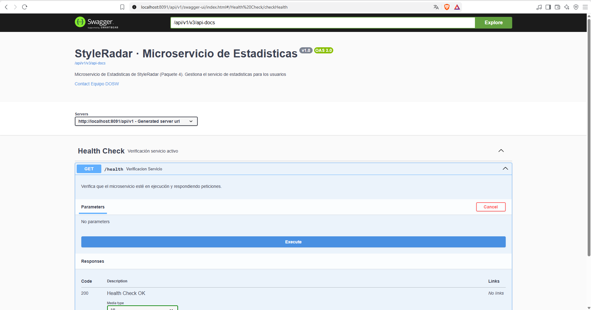

[⬅ Volver al README Principal](../../README.md)

---

## 3. ENDPOINTS Y ENLACE A SWAGGER

La documentación interactiva **OpenAPI 3.0** (con botón `Authorize` para tokens `Bearer JWT`) y los contratos de ejecución se encuentran configurados bajo el `context-path: /api/v1`:

### Matriz Oficial de Enlaces por Entorno (DEV, QA, PROD)

| Entorno | Estado | Propósito | URL Base del Servicio | Swagger OpenAPI UI | Health Check |
| :--- | :---: | :--- | :--- | :--- | :--- |
| **Desarrollo Local (DEV)** | Active | Entorno local de desarrollo y Docker Compose (`styleradar_statistics`) | `http://localhost:8420` | [Swagger UI Local](http://localhost:8420/api/v1/swagger-ui.html) | [`/api/v1/actuator/health`](http://localhost:8420/api/v1/actuator/health) |
| **Calidad / Pruebas (QA)** | Active | Despliegue continuo desde `develop` en Azure (`sr-ms-estadisticas-qa`) | `https://sr-ms-estadisticas-qa.azurewebsites.net` | [`/api/v1/swagger-ui.html`](https://sr-ms-estadisticas-qa.azurewebsites.net/api/v1/swagger-ui.html) | [`/api/v1/actuator/health`](https://sr-ms-estadisticas-qa.azurewebsites.net/api/v1/actuator/health) |
| **Producción (PROD)** | Configured | Despliegue productivo desde `master` en Azure (`sr-ms-estadisticas-prod`) | `https://sr-ms-estadisticas-prod.azurewebsites.net` | [`/api/v1/swagger-ui.html`](https://sr-ms-estadisticas-prod.azurewebsites.net/api/v1/swagger-ui.html) | [`/api/v1/actuator/health`](https://sr-ms-estadisticas-prod.azurewebsites.net/api/v1/actuator/health) |

* **Especificación OpenAPI (JSON Contrato):** `http://localhost:8420/api/v1/v3/api-docs`

<div align="center">
  
  <p><sub><b>Figura 3.1:</b> Documentación interactiva Swagger OpenAPI UI activa en <code>http://localhost:8420/api/v1/swagger-ui.html</code> mostrando los contratos REST y autenticación Bearer JWT.</sub></p>
</div>

### Tabla de Endpoints Expuestos

| Método | Endpoint | Descripción | Rol Requerido | Códigos HTTP |
| :---: | :--- | :--- | :--- | :---: |
| `GET` | `/api/v1/statistics/summary/totals/{metricCode}` | Consulta el total acumulado histórico (`FOUNDATION_GARMENTS_RECEIVED`, `PLATFORM_GARMENT_PUBLICATIONS`, `PLATFORM_PLAYLISTS_CREATED`) o del mes en curso (`PLATFORM_MONTHLY_DONATIONS`) (`SR-RF-82.1`, `SR-RF-86.4`, `SR-RF-86.5`, `SR-RF-86.6`). | `FOUNDATION_ADMIN` / `REPRESENTANTE_FUNDACION` o `PLATFORM_ADMIN` / `STYLERADAR_ADMIN` | `200`, `400`, `401`, `403` |
| `GET` | `/api/v1/statistics/time-series/{metricCode}` | Consulta series temporales diarias (`PLATFORM_USER_REGISTRATIONS`, mes actual por defecto) o mensuales (`PLATFORM_SUBSCRIPTION_REVENUE`, últimos 6 meses por defecto) con relleno de ceros (`SR-RF-88.2`, `SR-RF-89.1`). Parámetros opcionales: `startDate`, `endDate`, `granularity` (`DAY` \| `MONTH`). | `PLATFORM_ADMIN` / `STYLERADAR_ADMIN` / `ADMIN` | `200`, `400`, `401`, `403` |
| `GET` | `/api/v1/statistics/distributions/{metricCode}` | Consulta distribución por categorías y porcentajes de inventario por estado (`STORE_INVENTORY_BY_STATE`) o cuentas por plan (`PLATFORM_BUYERS_BY_PLAN`, `PLATFORM_STORES_BY_PLAN`) (`SR-RF-81`, `SR-RF-91.1`, `SR-RF-91.2`). | `STORE_ADMIN` / `ADMIN_ALMACEN` o `PLATFORM_ADMIN` / `STYLERADAR_ADMIN` | `200`, `400`, `401`, `403` |
| `GET` | `/api/v1/health` | Verificación de disponibilidad del servicio (`status`, `service`, `port`, `timestamp`). | Público | `200` |
| `GET` | `/api/v1/actuator/health` | Health Check operativo de Spring Boot Actuator (incluye estado de PostgreSQL). | Público | `200` |

### Matriz de los 9 Indicadores (`MetricCode`) y Alcance Autorizado

| `MetricCode` | RF | Endpoint | Alcance (`ScopeType`) | Roles Permitidos |
| :--- | :---: | :--- | :---: | :--- |
| `FOUNDATION_GARMENTS_RECEIVED` | `SR-RF-82.1` | `/statistics/summary/totals/{metricCode}` | `FOUNDATION` | `FOUNDATION_ADMIN`, `FOUNDATION_REPRESENTATIVE`, `REPRESENTANTE_FUNDACION`, `FOUNDATION` |
| `PLATFORM_GARMENT_PUBLICATIONS` | `SR-RF-86.4` | `/statistics/summary/totals/{metricCode}` | `PLATFORM` | `PLATFORM_ADMIN`, `STYLERADAR_ADMIN`, `ADMIN_STYLERADAR`, `ADMIN` |
| `PLATFORM_PLAYLISTS_CREATED` | `SR-RF-86.5` | `/statistics/summary/totals/{metricCode}` | `PLATFORM` | `PLATFORM_ADMIN`, `STYLERADAR_ADMIN`, `ADMIN_STYLERADAR`, `ADMIN` |
| `PLATFORM_MONTHLY_DONATIONS` | `SR-RF-86.6` | `/statistics/summary/totals/{metricCode}` | `PLATFORM` | `PLATFORM_ADMIN`, `STYLERADAR_ADMIN`, `ADMIN_STYLERADAR`, `ADMIN` |
| `PLATFORM_USER_REGISTRATIONS` | `SR-RF-88.2` | `/statistics/time-series/{metricCode}` | `PLATFORM` | `PLATFORM_ADMIN`, `STYLERADAR_ADMIN`, `ADMIN_STYLERADAR`, `ADMIN` |
| `PLATFORM_SUBSCRIPTION_REVENUE` | `SR-RF-89.1` | `/statistics/time-series/{metricCode}` | `PLATFORM` | `PLATFORM_ADMIN`, `STYLERADAR_ADMIN`, `ADMIN_STYLERADAR`, `ADMIN` |
| `STORE_INVENTORY_BY_STATE` | `SR-RF-81` | `/statistics/distributions/{metricCode}` | `STORE` | `STORE_ADMIN`, `ADMIN_ALMACEN`, `STORE`, `TIENDA` |
| `PLATFORM_BUYERS_BY_PLAN` | `SR-RF-91.1` | `/statistics/distributions/{metricCode}` | `PLATFORM` | `PLATFORM_ADMIN`, `STYLERADAR_ADMIN`, `ADMIN_STYLERADAR`, `ADMIN` |
| `PLATFORM_STORES_BY_PLAN` | `SR-RF-91.2` | `/statistics/distributions/{metricCode}` | `PLATFORM` | `PLATFORM_ADMIN`, `STYLERADAR_ADMIN`, `ADMIN_STYLERADAR`, `ADMIN` |

> [!NOTE]
> **Resolución Autoritativa del Scope:** El identificador de tienda (`storeId`) o fundación (`foundationId`) nunca se pasa en la URL; se extrae de forma segura desde los claims del token JWT (`storeId`/`idTienda`/`nit` o `foundationId`/`idFundacion`) o las cabeceras del API Gateway (`X-Store-Id`, `X-Foundation-Id`).

<details>
<summary><b>Click para ver Ejemplos Interactivos de Request y Response JSON (Payloads)</b></summary>

<br>

#### Ejemplo 1: Consultar Serie Temporal (`GET /api/v1/statistics/time-series/PLATFORM_USER_REGISTRATIONS`)

```bash
curl -X GET "http://localhost:8420/api/v1/statistics/time-series/PLATFORM_USER_REGISTRATIONS?startDate=2026-11-01&endDate=2026-11-03&granularity=DAY" \
  -H "Authorization: Bearer <JWT_TOKEN>"
```

##### Respuesta Exitosa (`200 OK`):

```json
{
  "metricCode": "PLATFORM_USER_REGISTRATIONS",
  "scopeType": "PLATFORM",
  "scopeId": "platform",
  "period": {
    "startDate": "2026-11-01",
    "endDate": "2026-11-03"
  },
  "granularity": "DAY",
  "points": [
    { "date": "2026-11-01", "value": 4 },
    { "date": "2026-11-02", "value": 0 },
    { "date": "2026-11-03", "value": 7 }
  ]
}
```

#### Ejemplo 2: Consultar Total Acumulado por Fundación (`GET /api/v1/statistics/summary/totals/FOUNDATION_GARMENTS_RECEIVED`)

```bash
curl -X GET "http://localhost:8420/api/v1/statistics/summary/totals/FOUNDATION_GARMENTS_RECEIVED" \
  -H "Authorization: Bearer <JWT_TOKEN>"
```

##### Respuesta Exitosa (`200 OK`):

```json
{
  "metricCode": "FOUNDATION_GARMENTS_RECEIVED",
  "scopeType": "FOUNDATION",
  "scopeId": "foundation-3",
  "period": null,
  "total": 128
}
```

#### Ejemplo 3: Consultar Distribución de Inventario (`GET /api/v1/statistics/distributions/STORE_INVENTORY_BY_STATE`)

```bash
curl -X GET "http://localhost:8420/api/v1/statistics/distributions/STORE_INVENTORY_BY_STATE" \
  -H "Authorization: Bearer <JWT_TOKEN>"
```

##### Respuesta Exitosa (`200 OK`):

```json
{
  "metricCode": "STORE_INVENTORY_BY_STATE",
  "scopeType": "STORE",
  "scopeId": "store-17",
  "entries": [
    { "categoryCode": "AVAILABLE", "count": 15, "percentage": 75.00 },
    { "categoryCode": "LOW_STOCK", "count": 3, "percentage": 15.00 },
    { "categoryCode": "OUT_OF_STOCK", "count": 2, "percentage": 10.00 }
  ]
}
```

#### Ejemplo 4: Respuesta de Error Estándar RFC 7807 (`GlobalExceptionHandler`)

```json
{
  "type": "https://api.styleradar.com/errors/access-denied",
  "title": "Forbidden",
  "status": 403,
  "detail": "STORE_ADMIN can only access STORE metrics",
  "instance": "/api/v1/statistics/summary/totals/PLATFORM_GARMENT_PUBLICATIONS",
  "code": "ACCESS_DENIED",
  "timestamp": "2026-11-25T21:00:00.000",
  "error": "Forbidden",
  "message": "STORE_ADMIN can only access STORE metrics",
  "path": "/api/v1/statistics/summary/totals/PLATFORM_GARMENT_PUBLICATIONS"
}
```

</details>

---

[⬅ Volver al README Principal](../../README.md)
