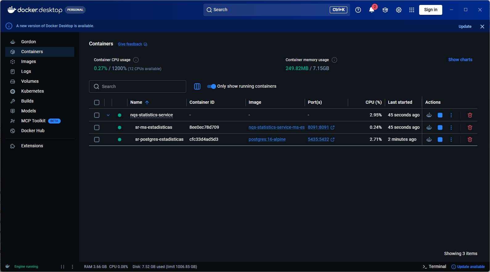

[⬅ Volver al README Principal](../../README.md)

---

## 6. CÓMO EJECUTAR LOCAL Y CON DOCKER

### Prerrequisitos de Entorno

* **Java Development Kit (JDK):** Versión 21 LTS instalada (`java -version`).
* **Apache Maven:** Versión 3.9+ instalada (`mvn -version`) o uso del wrapper incluido (`./mvnw` en Linux/macOS, `.\mvnw.cmd` en Windows).
* **Docker Engine & Docker Compose:** Versión 24+ en ejecución (`docker --version`).

### Ejecución Local con Maven (Perfil `dev`)

Cuando Spring Boot corre desde el host con `./mvnw` (o `mvn`), utiliza `application-dev.yml`, que apunta a PostgreSQL en `localhost:5435` y RabbitMQ sin SSL en `localhost:5672`:

```bash
# 1. Clonar el repositorio
git clone https://github.com/StyleRadar1/NQS-Statistics-Service.git
cd NQS-Statistics-Service

# 2. Levantar servicios de infraestructura en Docker (PostgreSQL 16 y RabbitMQ 3.12)
docker compose up -d postgres-estadisticas rabbitmq-estadisticas

# 3. Exportar la clave secreta JWT para validar peticiones Bearer en desarrollo
export JWT_SECRET=dGVzdC1zZWNyZXQta2V5LXRlc3Qtc2VjcmV0LWtleS10ZXN0LXNlY3JldA==

# 4. Ejecutar el microservicio localmente en el puerto 8420 (/api/v1)
./mvnw clean spring-boot:run -Dspring-boot.run.profiles=dev
```

> [!NOTE]
> **Parámetros de conexión al ejecutar con `./mvnw` desde el equipo host:**
> * **PostgreSQL (`styleradar_statistics`):** `localhost:5435` &nbsp;·&nbsp; Usuario: `styleradar_user` &nbsp;·&nbsp; Contraseña: `styleradar_secret`
> * **RabbitMQ Broker:** `localhost:5672` (Panel de administración en `http://localhost:15672`, credenciales `guest` / `guest`)
> * *Para usuarios en Windows (PowerShell):*  
>   `$env:JWT_SECRET="dGVzdC1zZWNyZXQta2V5LXRlc3Qtc2VjcmV0LWtleS10ZXN0LXNlY3JldA=="`  
>   `.\mvnw.cmd clean spring-boot:run "-Dspring-boot.run.profiles=dev"`

### Ejecución Contenerizada Completa con Docker Compose

El archivo `docker-compose.yml` levanta los 3 contenedores (`ms-estadisticas`, `postgres-estadisticas` y `rabbitmq-estadisticas`) dentro de la red puente `styleradar-net`:

<details>
<summary><b>Click para ver Instrucciones de Docker Compose y Tabla de Conexiones</b></summary>

<br>

```bash
# Levantar todos los servicios en segundo plano (build multi-stage + PostgreSQL + RabbitMQ)
docker compose up -d --build

# Verificar el estado de los contenedores
docker compose ps

# Visualizar logs en tiempo real del microservicio
docker compose logs -f ms-estadisticas

# Detener y eliminar los contenedores
docker compose down
```

#### Resolución de Conexiones según el Entorno de Ejecución

| Componente | Conexión con `./mvnw` (Host Local) | Conexión dentro de Docker Compose (Red Interna) |
| :--- | :--- | :--- |
| **PostgreSQL (`styleradar_statistics`)** | `localhost:5435` | `postgres-estadisticas:5432` |
| **RabbitMQ Broker** | `localhost:5672` | `rabbitmq-estadisticas:5672` |
| **RabbitMQ Management UI** | `http://localhost:15672` *(guest / guest)* | `http://localhost:15672` *(mapeado al host)* |
| **Microservicio Estadísticas** | `http://localhost:8420/api/v1` | `http://ms-estadisticas:8420/api/v1` *(mapeado a `localhost:8420`)* |

</details>

### Comprobación de Salud (Health Check)

Debido a que el microservicio define `server.servlet.context-path: /api/v1`, las rutas de salud se consultan bajo `/api/v1`:

```bash
curl -s http://localhost:8420/api/v1/actuator/health
# Esperado: {"status":"UP","components":{"db":{"status":"UP"},"diskSpace":{"status":"UP"},"ping":{"status":"UP"}}}

curl -s http://localhost:8420/api/v1/health
# Esperado: {"port":8420,"service":"ms-estadisticas","status":"UP","timestamp":"..."}
```

> [!NOTE]
> En `src/main/resources/application.yml`, el indicador `management.health.rabbit.enabled` está en `false`, por lo que `/api/v1/actuator/health` reporta `db`, `diskSpace` y `ping` sin incluir el componente `rabbit`.

<div align="center">
  
  <p><sub><b>Figura 6.1:</b> Ejecución de <code>docker compose ps</code> verificando los contenedores levantados y en estado saludable en el entorno local.</sub></p>
</div>

---

[⬅ Volver al README Principal](../../README.md)
