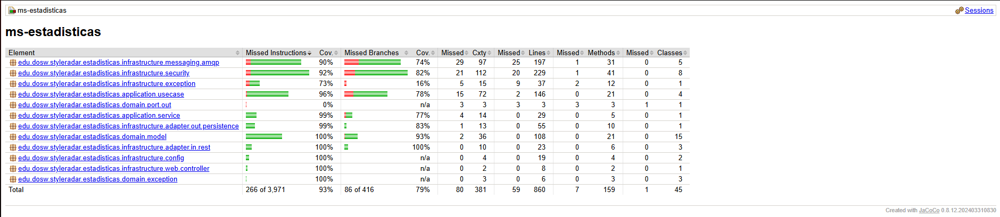

[⬅ Volver al README Principal](../../README.md)

---

## 8. PRUEBAS Y COBERTURA (≥ 85%)

El proyecto exige una cobertura mínima de líneas del **85%** (`jacoco.min.line.coverage = 0.85`) verificada automáticamente mediante el plugin de **JaCoCo** durante la fase `verify` de Maven.

### Comandos de Ejecución de Pruebas

```bash
# Ejecutar la suite completa de pruebas y verificar la regla JaCoCo (>= 85% líneas)
./mvnw clean verify

# Generar únicamente el reporte HTML de cobertura JaCoCo
./mvnw jacoco:report
```

* **Ruta del Reporte HTML:** `target/site/jacoco/index.html`

### Métricas Actuales de Cobertura en el Repositorio

* **Pruebas Automatizadas en el Repositorio:** **52 pruebas** distribuidas en **19 clases de test** (dominio, casos de uso, servicio de relleno de series temporales, adaptador JPA sobre H2 en modo PostgreSQL, mensajería AMQP e idempotencia, filtros de seguridad JWT/Gateway/CorrelationId, controladores MockMvc y manejo global de excepciones RFC 7807).
* **Cobertura JaCoCo Alcanzada:** **93% de instrucciones** (`3,705/3,971`), **93.1% de líneas** (`801/860`) y **79% de ramas** (`330/416`), con **100%** en `domain.model`, `domain.exception`, `rest`, `web.controller` y `config`, superando el umbral mínimo obligatorio del 85%.
* **Base de Datos de Pruebas:** H2 en memoria configurada con `MODE=PostgreSQL` (`src/test/resources/application.yml`), sin depender de contenedores externos en `mvn verify`.
* **Umbral Obligatorio en CI (`build-and-test`):** Cobertura de líneas (`LINE`) $\ge 85\%$, validado en cada push o Pull Request hacia `develop`, `master` y `main`.
* **Documentación de Seguridad y OWASP Top 10:2025:** [`../security/SR_NQS_Seguridad_y_OWASP_2025.md`](../security/SR_NQS_Seguridad_y_OWASP_2025.md).

<div align="center">
  
  <p><sub><b>Figura 8.1:</b> Reporte consolidado de cobertura HTML generado por JaCoCo (<code>target/site/jacoco/index.html</code>), evidenciando el cumplimiento del umbral mínimo obligatorio de líneas del 85%.</sub></p>
</div>

### Pirámide de Pruebas Implementada

| Nivel de Prueba | Alcance | Tecnologías Utilizadas | Ubicación en el Código | Cobertura Meta |
| :--- | :--- | :--- | :--- | :---: |
| **Pruebas Unitarias de Dominio y Aplicación** | Validaciones de records de dominio, casos de uso y `TimeSeriesGapFiller` | JUnit 5, Mockito | `src/test/java/.../domain/model/`, `src/test/java/.../application/` | ≥ 90% |
| **Pruebas de Persistencia** | Repositorios JPA, `upsertDailyIncrement` y ajustes de distribución | Spring Data JPA, H2 (`MODE=PostgreSQL`) | `src/test/java/.../infrastructure/adapter/out/persistence/` | ≥ 85% |
| **Pruebas de Mensajería AMQP** | Mapeo `DomainEventMapper`, `DomainEventListener` e idempotencia `processed_event` | JUnit 5, Mockito | `src/test/java/.../infrastructure/messaging/amqp/` | ≥ 85% |
| **Pruebas de Seguridad y Filtros** | Validación JWT `HS256`, `AuthenticatedScopeResolver`, `CorrelationIdFilter` y rutas HTTP | JUnit 5, MockMvc, Spring Security Test | `src/test/java/.../infrastructure/security/` | ≥ 85% |
| **Pruebas de Controladores, OpenAPI y Errores** | Endpoints REST, contratos JSON, `GlobalExceptionHandler` RFC 7807 y `OpenApiConfig` | MockMvc, Spring Boot Test | `src/test/java/.../infrastructure/adapter/in/rest/`, `.../infrastructure/web/controller/`, `.../infrastructure/exception/`, `.../infrastructure/config/` | ≥ 85% |

> [!IMPORTANT]
> **Criterio de Fallo en CI (`pom.xml`):** La regla de JaCoCo exige `<counter>LINE</counter><minimum>0.85</minimum>` sobre el bundle compilado, excluyendo únicamente `EstadisticasApplication.class`, `.../rest/doc/**`, `.../application/dto/**` y `.../persistence/entity/**`. Si la cobertura de líneas cae por debajo del 85%, `./mvnw verify` falla y bloquea el pipeline.

---

[⬅ Volver al README Principal](../../README.md)
