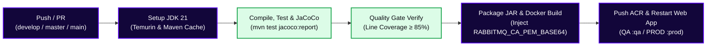
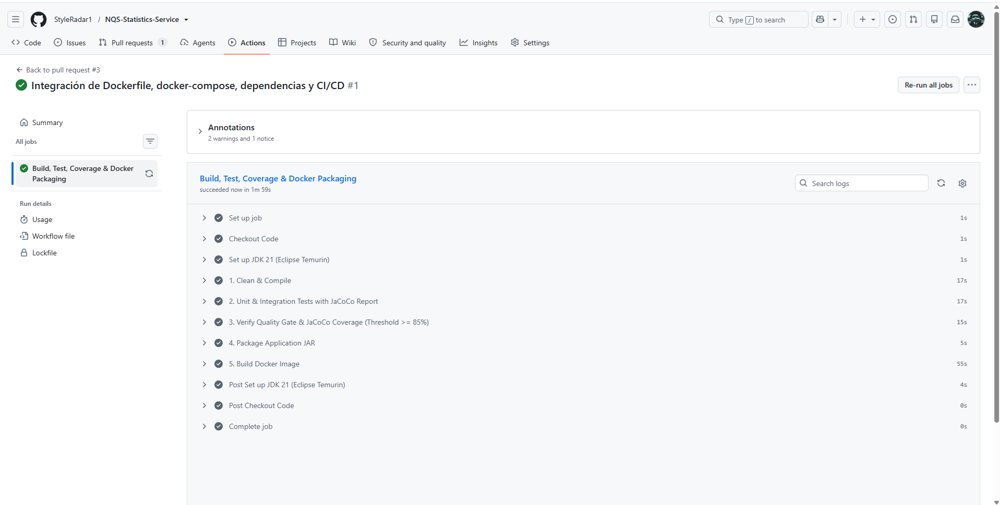

[⬅ Volver al README Principal](../../README.md)

---

## 9. CI/CD CON EL BADGE DEL PIPELINE

El ciclo de vida del microservicio implementa integración y entrega continua automatizada mediante **GitHub Actions** (`.github/workflows/ci-cd.yml`), **Azure Container Registry (`acrstyleradarestadisticas.azurecr.io`)** y **Azure App Service**.

### Badges de Pipelines y Calidad (GitHub Actions)

  
  
  
  

### Matriz de Pipelines en `.github/workflows/ci-cd.yml`

| Job / Pipeline | Rama / Entorno | Trigger de Ejecución | Quality Gate y Acciones Ejecutadas | Estado |
| :--- | :---: | :--- | :--- | :---: |
| **CI (`build-and-test`)** | `develop`, `master`, `main` *(y PRs hacia estas ramas)* | `push` o `pull_request` hacia `develop`, `master` o `main` | Setup JDK 21 Temurin + caché Maven → `mvn -B clean compile` → `mvn -B test jacoco:report` → `mvn -B verify` (JaCoCo ≥ 85%) → `mvn -B package -DskipTests` → `docker build` (`sr-ms-estadisticas:latest` con `RABBITMQ_CA_PEM_BASE64`) |  |
| **CD QA (`deploy-qa`)** | `develop` *(Azure QA · `sr-ms-estadisticas-qa`)* | `push` directo a `develop` (requiere `build-and-test` en verde) | Valida secreto `RABBITMQ_CA_PEM_BASE64` → `azure/login@v2` → ACR push (`acrstyleradarestadisticas.azurecr.io/sr-ms-estadisticas:qa`) → `az webapp restart --name sr-ms-estadisticas-qa` |  |
| **CD PROD (`deploy-prod`)** | `master` / `main` *(Azure PROD · `sr-ms-estadisticas-prod`)* | `push` directo a `master` o `main` (requiere `build-and-test` en verde) | Valida secreto `RABBITMQ_CA_PEM_BASE64` → `azure/login@v2` → ACR push (`acrstyleradarestadisticas.azurecr.io/sr-ms-estadisticas:prod`) → `az webapp restart --name sr-ms-estadisticas-prod` |  |

### Diagrama del Flujo Automatizado (Pipeline Stages)

### Estructura de Jobs en `.github/workflows/ci-cd.yml`

1. **`build-and-test`:**
   - Ejecuta sobre `ubuntu-latest` con JDK 21 (Eclipse Temurin) y caché de dependencias Maven.
   - Ejecuta compilación (`mvn -B clean compile`), suite de pruebas con reporte (`mvn -B test jacoco:report`), verificación de cobertura mínima del 85% (`mvn -B verify`), empaquetado del JAR (`mvn -B package -DskipTests`) y validación del `Dockerfile` inyectando `RABBITMQ_CA_PEM_BASE64` para generar `/app/rabbitmq-truststore.jks`.
2. **`deploy-qa`:**
   - Se dispara únicamente en `push` a `develop` tras completar `build-and-test`.
   - Verifica el secreto `RABBITMQ_CA_PEM_BASE64`, autentica en Azure (`AZURE_CREDENTIALS`), construye y publica la imagen `:qa` en `acrstyleradarestadisticas.azurecr.io` y reinicia `sr-ms-estadisticas-qa` en `rg-styleradar-estadisticas-qa`.
3. **`deploy-prod`:**
   - Se dispara únicamente en `push` a `master` o `main` tras completar `build-and-test`.
   - Construye y publica la imagen `:prod` en `acrstyleradarestadisticas.azurecr.io` y reinicia `sr-ms-estadisticas-prod` en `rg-styleradar-estadisticas-prod`.

  
  
<b>Figura 9.1:</b> Ejecución exitosa del pipeline automatizado de CI/CD en GitHub Actions (<code>.github/workflows/ci-cd.yml</code>), validando compilación con JDK 21, pruebas automatizadas, Quality Gate JaCoCo ≥ 85% y empaquetado Docker.

---

[⬅ Volver al README Principal](../../README.md)
