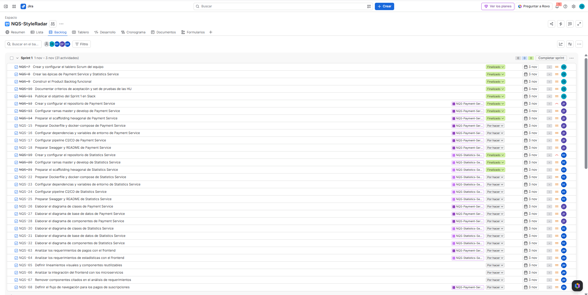

[⬅ Volver al README Principal](../../README.md)

---

## 12. EQUIPO, RESPONSABLES Y ENLACE A LA ÉPICA EN JIRA

### Equipo y Responsables del Microservicio

Desarrollado y mantenido por el **Squad NQS (`No Queremos Scrum`)** para la asignatura DOSW 2026.

  

| Rol | Nombre Completo | Usuario GitHub |
| :---: | :---: | :---: |
| **Líder del Equipo** | Cristian Camilo Ortiz Sanchez | [@CatrachoINXS](https://github.com/CatrachoINXS) |
| **Desarrollador Backend** | Juan Manuel Garzón Viracacha | [@JuanMaGV1](https://github.com/JuanMaGV1) |
| **Desarrollador Backend** | Daniel Jose Villamizar Castellanos | [@ChanguaLover4ever](https://github.com/ChanguaLover4ever) |
| **Desarrollador Frontend** | Julian Felipe Morales Zambrano | [@JulianMorales2003](https://github.com/JulianMorales2003) |

---

### Enlaces de Gestión, Repositorios y Evidencias

El seguimiento de requerimientos, historias de usuario del Sprint y artefactos del proyecto se centraliza en los siguientes enlaces oficiales:

* **Repositorio Oficial en GitHub:** [https://github.com/StyleRadar1/NQS-Statistics-Service](https://github.com/StyleRadar1/NQS-Statistics-Service)
* **Organización Oficial de StyleRadar:** [https://github.com/StyleRadar1](https://github.com/StyleRadar1)
* **Épica Oficial del Microservicio (Jira):** [https://mail-team-hdkr3g6f.atlassian.net/browse/NQS-6](https://mail-team-hdkr3g6f.atlassian.net/browse/NQS-6)
* **Tablero Scrum del Squad (Jira):** [https://mail-team-hdkr3g6f.atlassian.net/jira/software/projects/NQS/boards/1?filter=&groupBy=none](https://mail-team-hdkr3g6f.atlassian.net/jira/software/projects/NQS/boards/1?filter=&groupBy=none)
* **Swagger UI Local (Puerto 8420):** [http://localhost:8420/api/v1/swagger-ui.html](http://localhost:8420/api/v1/swagger-ui.html)
* **Especificación OpenAPI JSON:** [http://localhost:8420/api/v1/v3/api-docs](http://localhost:8420/api/v1/v3/api-docs)

  
  
<b>Figura 12.1:</b> Épica oficial <code>NQS-6</code> y tablero Scrum en Atlassian Jira para <code>ms-estadisticas</code> (puerto 8420), detallando los requerimientos funcionales y el desglose de historias de usuario del Sprint.

### Requerimientos Funcionales Asignados (Alcance Vigente · 9 Indicadores Core)

| Código RF | Nombre del Requerimiento | Historia en Jira | Actor Principal | Criterio de Aceptación Clave |
| :---: | :--- | :---: | :--- | :--- |
| `SR-RF-81` | Consultar inventario por estado (`STORE_INVENTORY_BY_STATE`) | `NQS-41` | Administrador de Tienda | Clasifica stock (`0` = `OUT_OF_STOCK`, `1..3` = `LOW_STOCK`, `>= 4` = `AVAILABLE`) y retorna conteos y porcentajes de la tienda autenticada. |
| `SR-RF-82.1` | Consultar prendas recibidas por fundación (`FOUNDATION_GARMENTS_RECEIVED`) | `NQS-42` | Representante de Fundación | Retorna el total acumulado histórico de prendas recibidas para la fundación autenticada (`period: null`). |
| `SR-RF-86.4` | Consultar total de prendas publicadas (`PLATFORM_GARMENT_PUBLICATIONS`) | `NQS-46` | Administrador de Plataforma | Retorna el total acumulado histórico de prendas publicadas a partir de `styleradar.catalogo.prenda.publicada`. |
| `SR-RF-86.5` | Consultar total de playlists creadas (`PLATFORM_PLAYLISTS_CREATED`) | `NQS-46` | Administrador de Plataforma | Retorna el total acumulado histórico de playlists creadas a partir de `styleradar.playlist.creada`. |
| `SR-RF-86.6` | Consultar donaciones del mes (`PLATFORM_MONTHLY_DONATIONS`) | `NQS-46` | Administrador de Plataforma | Retorna el total de donaciones completadas durante el mes calendario en curso (`America/Bogota`). |
| `SR-RF-88.2` | Consultar registros diarios de usuarios (`PLATFORM_USER_REGISTRATIONS`) | `NQS-48` | Administrador de Plataforma | Retorna serie temporal diaria (`DAY`) del mes solicitado o actual, rellenando con `0` los días sin registros. |
| `SR-RF-89.1` | Consultar histórico mensual de ingresos (`PLATFORM_SUBSCRIPTION_REVENUE`) | `NQS-49` | Administrador de Plataforma | Retorna serie temporal mensual (`MONTH`) de los últimos 6 meses por defecto con la suma en COP de pagos aprobados. |
| `SR-RF-91.1` | Consultar cuentas de compradores por plan (`PLATFORM_BUYERS_BY_PLAN`) | `NQS-51` | Administrador de Plataforma | Retorna conteo y porcentaje de compradores distribuidos en `PLAN_RADAR` y `PLAN_RADAR_PLUS`. |
| `SR-RF-91.2` | Consultar cuentas de almacenes por plan (`PLATFORM_STORES_BY_PLAN`) | `NQS-51` | Administrador de Plataforma | Retorna conteo y porcentaje de tiendas distribuidas en `PLAN_STORE_MONTHLY` y `SUSPENDED`. |

> [!NOTE]
> **Trazabilidad del Backlog Histórico:** En la refactorización `refactor/core-nine-metrics` se retiraron las métricas que dependían de endpoints y eventos fuera de alcance (`SR-RF-76`, `SR-RF-77`, `SR-RF-78`, `SR-RF-79`, `SR-RF-80`, `SR-RF-83`, `SR-RF-84`, `SR-RF-85`, `SR-RF-87` y `SR-RF-90`), concentrando el backlog activo en los 9 indicadores core listados arriba.

---

[⬅ Volver al README Principal](../../README.md)
